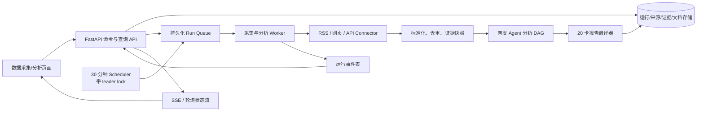

# StockAgents 重构规划（修订版）

> 修订日期：2026-07-31  
> 状态：可以进入开发  
> 原则：完整保留原系统 7 个业务页面及其前后端功能，在其上只新增“数据采集/分析”和“投资引擎”两个页面；增加两支信息团队，并接入最新 AI 原生金融多 Agent 框架。

## 1. 修订后的明确结论

本次重构不删除 `build_system` 和 `ai_coding`，不重做登录交互，也不修改智能体团队、议事广场、技能萃取、Agent 记忆、数字孪生 Office、Token 节省、生态配置的现有前后端功能。

系统主流程确定为：

```text
打开系统
  → 原登录页（只替换产品关键词）
  → 登录成功进入 Agent Config
  → 用户配置模型、API Key、Skills、Tools 和团队
  → 在“数据采集/分析”新页面运行两支信息团队并查看动态 HTML
  → 在“投资引擎”新页面选择信息源
  → TradingAgents 驱动投资分析与模拟决策
  → 投资引擎页面展示 Agent 全过程与结果
```

Plaza 是冻结保留的原能力，不承担本轮投资引擎 UI。投资模拟必须在独立新页面完成；不能为了赶进度改写 Plaza。若未来确需把模拟事件同步到 Plaza，必须另立需求并先通过原功能回归。

## 2. 登录页与首个页面

### 2.1 登录页

保留现有 `src/frontend/login.html` 的：

- HTML 结构与浅色视觉样式；
- 登录、注册、访客模式；
- Cookie、CSRF、Token 和错误处理；
- `next` 参数的安全跳转逻辑；
- 所有现有 API 调用。

只更换以下产品关键词：

| 当前文案 | 新文案 |
| --- | --- |
| `AgentsGroup2026 — 登录` | `StockAgents — 登录` |
| 印章 `智` | 印章 `投` |
| `AgentsGroup2026` | `StockAgents` |
| `智能体团队管理平台` | `AI 信息采集与股票投资模拟平台` |
| `Standalone Agent Platform` | `Agentic Market Intelligence Platform` |

不在这个任务中重新设计布局、表单或认证体系。

### 2.2 登录后默认进入 Agent Config

现有代码已经默认跳转 `/agent-team-config.html`，本次只做回归保护：

- 登录、注册、访客模式都默认进入 Agent Config；
- 合法 `next=/...` 仍可覆盖默认页面；
- 已登录用户访问 `/login.html` 时直接进入 Agent Config；
- `/` 继续跳转登录页；
- 新增自动化测试锁定上述行为。

Agent Config 是系统控制台。用户必须先在这里选择/配置：

- Quick Think 模型；
- Deep Think 模型；
- 模型提供商与 API 地址；
- API Key 的环境变量引用；
- Agent 的 Skills、Tools、预算和权限；
- 两支信息团队的来源与运行频率；
- 两支新团队需要使用的模型、Skills、Tools、预算和权限。

TradingAgents 的分析师组合、辩论轮数、风险轮数和信息源编排放在新“投资引擎”页面，不扩写 Agent Config 页面职责。

## 3. 团队加载策略

### 3.1 运行时只保留四支团队

Agent Config 和 `storage/teams/teams.json` 的产品运行时白名单固定为：

- `build_system`；
- `ai_coding`；
- `ai_news_60s`；
- `dufu_world_intel`。

历史团队 factory 和旧记录不再启动播种；应用启动时会受控清理持久化记录，避免旧团队出现在下拉框。`build_system` 与 `ai_coding` 仍是核心启动验收项，两个信息团队是数据采集/分析能力的必需项。

### 3.2 新增两支团队

新增 factory：

```text
src/backend/agents/teams/ai_news_60s_team.py
src/backend/agents/teams/dufu_world_intel_team.py
```

启动时遵循现有规则：磁盘已有团队则使用持久化版本；磁盘没有才用 factory 首次播种，避免重启覆盖用户修改。

### 3.3 启动健康检查

新增核心团队断言：

```python
CORE_TEAM_IDS = {
    "build_system",
    "ai_coding",
    "ai_news_60s",
    "dufu_world_intel",
}

missing = CORE_TEAM_IDS - set(team_manager.team_ids())
if missing:
    report_startup_error(missing)
```

新框架作为可选运行时依赖。即使它暂时不可用，7 个原业务页面、Build System、AI Coding 和数据采集/分析页面的非投资能力仍然能正常打开。

## 4. 新增团队设计

### 4.1 60 秒 AI 信息播报团队 `ai_news_60s`

该团队参考“60 秒播报”的节奏与信息密度，不复制具体账号的声音、形象、口头禅或原文。

| Agent | 核心职责 | Tools | Skills |
| --- | --- | --- | --- |
| `ai60_lead` | 选题、拆解任务、控制时间预算、发布门禁 | `delegate_task`, `schedule_task`, `memory_read`, `publish_event` | `editorial_planning`, `news_ranking`, `quality_gate` |
| `ai60_scout` | 搜索官方发布、论文、开源项目、产品和政策 | `web_search`, `navigate_url`, `web_extract`, `memory_save` | `ai_source_discovery`, `ai_taxonomy`, `source_reputation` |
| `ai60_checker` | 去重、交叉验证、日期/实体/数字核验 | `web_search`, `web_extract`, `run_python`, `memory_read` | `fact_checking`, `deduplication`, `citation_audit` |
| `ai60_market_mapper` | 映射公司、产业链、赛道、机会和风险 | `run_python`, `memory_read`, `read_file` | `entity_resolution`, `market_impact_mapping`, `scenario_analysis` |
| `ai60_editor` | 生成 60 秒版与可展开长版 | `read_file`, `memory_read` | `sixty_second_brief`, `plain_language_editing`, `uncertainty_labeling` |
| `ai60_publisher` | 输出动态 HTML 并发布 | `read_file`, `write_file`, `publish_event` | `hugohe3`, `accessible_html`, `data_visualization` |

固定产物：

```text
一句话总览
→ 5 条 AI 快讯
→ 为什么重要
→ 相关公司/赛道（明确非投资建议）
→ 风险与反证
→ 原始来源、数据截止时间、运行 ID
```

### 4.2 独夫之心团队 `dufu_world_intel`

该团队参考宏观议题、历史纵深、因果链和观点表达方式，但必须把事实、分析、推断和情景清楚分开。

| Agent | 核心职责 | Tools | Skills |
| --- | --- | --- | --- |
| `dufu_lead` | 议题拆解、调度、最终结论门禁 | `delegate_task`, `mixture_of_agents`, `schedule_task`, `publish_event` | `intelligence_planning`, `scenario_tree`, `editorial_gate` |
| `dufu_web_collector` | 多语言公开来源和 WebSearch 采集 | `web_search`, `navigate_url`, `web_extract`, `memory_save` | `multilingual_search`, `timeline_building`, `source_reputation` |
| `dufu_data_engineer` | 清洗、去重、实体对齐、时序对齐 | `run_python`, `read_file`, `write_file` | `data_cleaning`, `entity_resolution`, `timeseries_alignment` |
| `dufu_data_analyst` | 统计分析、数据挖掘、趋势与异常识别 | `run_python`, `memory_read`, `memory_save` | `data_analysis`, `data_mining`, `change_point_detection` |
| `dufu_red_team` | 查找反证、偏差和替代解释 | `web_search`, `web_extract`, `mixture_of_agents` | `claim_challenge`, `bias_detection`, `confidence_calibration` |
| `dufu_market_mapper` | 宏观事件到行业、公司和市场的传导路径 | `run_python`, `memory_read` | `macro_to_market`, `transmission_path`, `scenario_analysis` |
| `dufu_presenter` | 使用 `hugohe3` 生成动态数据页面 | `read_file`, `write_file`, `run_javascript`, `publish_event` | `hugohe3`, `interactive_storytelling`, `accessible_html` |

固定产物：

```text
发生了什么
→ 历史时间线
→ 核心驱动因素
→ 数据与趋势强度
→ 主要观点与反证
→ 乐观/基准/悲观情景
→ 对行业和股票的可能传导路径
→ 引用、更新时间和不确定性
```

当前仓库没有 `hugohe3`，因此实现一个仓库内置的同名 Skill 和 renderer adapter。输入为受控 JSON schema，输出为响应式 HTML。若之后提供外部同名 Skill，只替换 adapter，不改变团队配置。

## 5. 最新 AI 投资框架选择

### 5.1 唯一主框架：TradingAgents v0.3.1

不再采用 LEAN、FinRL-X、Qlib 或 VectorBT 作为本项目主引擎。

本项目集成 [TauricResearch/TradingAgents v0.3.1](https://github.com/TauricResearch/TradingAgents/releases/tag/v0.3.1)，固定到已签名 tag `v0.3.1` / commit `01477f9`。它在 2026-07-05 发布，是当前最新正式版本，使用 Apache-2.0 许可证。

选择原因：

- 原生 LangGraph 多 Agent 金融工作流；
- 市场、情绪、新闻、基本面四类分析师；
- 看多/看空研究员结构化辩论；
- Trader Agent；
- 激进/保守/中性风险辩论；
- Portfolio Manager 最终批准或拒绝；
- 持久化决策日志和收益反思；
- SQLite checkpoint 与按图结构恢复；
- 支持 OpenAI、Claude、Gemini、Grok、DeepSeek、Qwen、GLM、MiniMax、Kimi、Groq、Mistral、NVIDIA NIM、Bedrock、Ollama 和 OpenAI-compatible 本地服务；
- v0.3.x 提供可验证的数据访问契约、FRED、Polymarket、无界面报告输出和未来数据过滤。

官方资料：

- [项目与架构](https://github.com/TauricResearch/TradingAgents)
- [v0.3.1 Release](https://github.com/TauricResearch/TradingAgents/releases/tag/v0.3.1)
- [Changelog](https://github.com/TauricResearch/TradingAgents/blob/main/CHANGELOG.md)
- [Apache-2.0 License](https://github.com/TauricResearch/TradingAgents/blob/main/LICENSE)

### 5.2 集成方式

TradingAgents 不替换现有 AgentsGroup 内核。两者职责如下：

| 层 | 负责内容 |
| --- | --- |
| 现有 StockAgents | 登录、Agent Config、团队、Skills、Tools、任务、预算、记忆、证据、Plaza、页面与 API |
| TradingAgents | 股票研究 Agent 图、多空辩论、风险辩论、Trader、Portfolio Manager 和决策反思 |
| Adapter | 模型映射、信息上下文注入、事件转换、报告保存、投资引擎事件流和错误隔离 |

新增适配层：

```text
src/backend/integrations/tradingagents/
  config_mapper.py
  graph_adapter.py
  context_provider.py
  event_bridge.py
  report_adapter.py
  health.py
```

不直接修改第三方源码。版本升级只在 adapter 边界处理。

### 5.3 Agent Config 到 TradingAgents 的模型映射

```python
def map_agent_config(team_config, model_pool):
    return {
        "llm_provider": normalize_provider(team_config.provider),
        "deep_think_llm": model_pool[team_config.deep_model_id].name,
        "quick_think_llm": model_pool[team_config.quick_model_id].name,
        "backend_url": model_pool[team_config.deep_model_id].api_base_url,
        "output_language": "zh-CN",
        "max_debate_rounds": team_config.debate_rounds,
        "max_risk_discuss_rounds": team_config.risk_rounds,
        "checkpoint_enabled": True,
        "data_cache_dir": project_storage / "tradingagents/cache",
        "results_dir": project_storage / "tradingagents/results",
    }
```

API Key 只在服务端通过现有 SecretStore/环境变量解析，不写入团队 JSON，不传到浏览器。

### 5.4 两支信息团队如何进入 TradingAgents

在每次模拟前，系统先读取两个团队最新且已通过门禁的文档版本，按 ticker、行业、主题和时间窗口筛选上下文，再注入 TradingAgents 的运行 state：

```python
class StockAgentsTradingGraph(TradingAgentsGraph):
    def resolve_instrument_context(self, ticker, asset_type="stock"):
        base = super().resolve_instrument_context(ticker, asset_type)
        context = source_context_provider.for_ticker(
            ticker=ticker,
            before=self.trade_date,
            channels=["ai_news_60s", "dufu_world_intel"],
        )
        return base + context.to_prompt(max_tokens=CONTEXT_BUDGET)
```

只注入当时已经发布的信息，保留文档版本、来源和时间，防止历史模拟读取未来文档。

## 6. 投资模拟的产品形态

### 6.1 第一阶段：AI 决策模拟

TradingAgents 生成结构化研究和最终交易决定，StockAgents 增加一个轻量 Paper Portfolio：

- 初始现金；
- 股票与数量；
- BUY/SELL/HOLD；
- 模拟成交价格；
- 现金和持仓变化；
- 已实现/未实现收益；
- 每次决定引用的 Agent 报告；
- 下一次同 ticker 运行时的结果反思。

这是 AI Agent 投资决策模拟，不承诺传统量化回测的逐笔撮合精度。

### 6.2 投资引擎页面

新增 `/investment-engine.html`：

- 选择 ticker、日期、初始资金；
- 选择 Quick/Deep 模型；
- 选择启用的 TradingAgents 分析师；
- 选择 AI 快报/世界趋势信息源；
- 设置多空辩论轮数和风险轮数；
- 启动、暂停、取消、恢复；
- 查看 Agent 时间线、研究报告、最终决定、模拟持仓和收益；
- 后续加入拖放式来源选择。

### 6.3 投资引擎事件流

投资引擎通过自己的 run event stream 展示完整过程：

```text
Market/Sentiment/News/Fundamentals Analyst 离席采集
→ 回场提交报告
→ Bull 与 Bear 研究员辩论
→ Research Manager 总结
→ Trader 提交交易计划
→ Aggressive/Neutral/Conservative 风险辩论
→ Portfolio Manager 裁决
→ Paper Portfolio 模拟成交
→ 结果写入记忆并进入下一轮反思
```

```python
async for event in trading_graph.stream(run):
    investment_event_store.append(
        run_id=run.run_id,
        agent_role=map_role(event.node),
        status=map_status(event),
        content=safe_summary(event.output),
        evidence_refs=event.evidence_refs,
    )
```

Plaza 不订阅这些事件，也不新增投资讨论类型。这样投资引擎可以独立迭代，原 Plaza 的 API、SSE、讨论、共识、任务分配和 3D 会场不发生行为变化。

## 7. 页面保留与新增

| 页面 | 处理方式 |
| --- | --- |
| `/login.html` | 保留结构，只改关键词 |
| `/agent-team-config.html` | **原样保留**；登录后首页，新团队沿用现有配置能力 |
| `/plaza.html` | **原样保留**议事广场及相关后台功能 |
| `/skill-extract.html` | **原样保留**技能萃取及相关后台功能 |
| `/agent-memory.html` | **原样保留** Agent 记忆及相关后台功能 |
| `/Agent-digital-twin.html?office3d=1` | **原样保留**数字孪生 Office 及相关后台功能 |
| `/cost-dashboard.html` | **原样保留** Token 节省及相关后台功能 |
| `/pet-config.html` | **原样保留**生态配置及相关后台功能 |
| `/data-intelligence.html` | **新增页面 1**：来源配置、采集运行、分析、60 秒 AI 与世界趋势动态 HTML |
| `/investment-engine.html` | **新增页面 2**：来源拖放、TradingAgents 配置、运行时间线、报告和模拟账户 |

不得再新增 `/sources.html`、`/ai-brief.html`、`/world-trends.html` 或 `/investment-simulator.html` 等独立页面；这些视图全部收敛到上述两个新页面。全局导航只追加两个入口，不删除或改写旧入口。

## 8. API 规划

```text
/api/v1/trading-runtime
  GET  /health
  GET  /config-schema
  POST /config/validate

/api/v1/information-sources
  GET/POST /
  GET/PATCH/DELETE /{id}
  POST /{id}/test
  POST /teams/{team_id}/run

/api/v1/information-documents
  GET /
  GET /latest/{channel}
  GET /{id}/versions/{version}

/api/v1/investment-simulations
  GET/POST /
  GET /{run_id}
  POST /{run_id}/start
  POST /{run_id}/cancel
  GET /{run_id}/events
  GET /{run_id}/reports
  GET /{run_id}/portfolio

/api/v1/investment-simulations/{run_id}/events
  仅服务新投资引擎页面，不修改 Plaza API
```

## 9. 实施阶段

### Phase 0：保护原系统

- 建立当前测试基线；
- 锁定登录跳转、Build System、AI Coding 和 Plaza 行为；
- 补齐可复现依赖。

### Phase 1：登录文案与两支新团队

- 修改登录关键词；
- 新增两个 team factory；
- 增加启动注册与强制团队健康检查；
- Agent Config 能配置新团队的模型、Skills、Tools。

### Phase 2：数据采集/分析页面与动态 HTML

- 实现可插拔来源；
- 实现两支团队的任务 DAG；
- 实现 `hugohe3`；
- 新增唯一的 `/data-intelligence.html`，在页面内部发布 AI 快报和世界趋势视图。

### Phase 3：TradingAgents v0.3.1

- 固定依赖和许可证；
- 实现 config mapper、graph adapter、context provider、event bridge；
- Agent Config 驱动 Quick/Deep 模型；
- 保存报告、决策和 checkpoint。

### Phase 4：投资引擎后端

- 建立独立的模拟运行和事件流；
- 流式记录每个 TradingAgents 节点；
- 实现 Paper Portfolio；
- 不修改 Plaza API 或页面。

### Phase 5：投资引擎页面

- 新增唯一的 `/investment-engine.html`；
- 选择信息源和模型；
- 展示时间线、辩论、报告、决策和模拟账户；
- 评估并加入拖放式来源编排。

### Phase 6：测试、README 和发布

- 安全、失败隔离、历史日期和成本测试；
- 重写 README，所有命令按实际代码验证；
- 明确研究用途与非投资建议。

## 10. 验收标准

1. 登录页布局和功能不变，只显示 StockAgents 新关键词。
2. 登录、注册、访客和已登录重定向默认进入 Agent Config。
3. `build_system` 和 `ai_coding` 每次正常加载，持久化版本不被 factory 覆盖。
4. `ai_news_60s` 与 `dufu_world_intel` 能在 Agent Config 查看和编辑。
5. 智能体团队、议事广场、技能萃取、Agent 记忆、数字孪生 Office、Token 节省、生态配置的现有前后端功能继续通过测试。
6. 两支新团队能从 fixture 完成采集到动态 HTML 的全链路。
7. TradingAgents 固定为 v0.3.1，并能使用 Agent Config 中的 Quick/Deep 模型运行。
8. 两个信息团队的已发布文档能作为带版本和时间边界的上下文进入 TradingAgents。
9. TradingAgents 节点事件能实时出现在投资引擎页面的独立运行时间线中。
10. 模型或 TradingAgents 不可用时，7 个原业务页面不崩溃，投资引擎给出可操作错误。
11. 一次模拟能产生分析报告、多空辩论、风险辩论、最终决定和 Paper Portfolio 变化。
12. README 只描述实际完成的功能，启动命令在干净环境验证通过。

## 11. 责任划分

- **Grok**：全部仓库代码、框架集成、团队、两个新页面、API、测试、迁移和 README。
- **Codex**：两种内容结构的外部研究、外部信息源目录、框架研究、来源覆盖与偏差审计；交付带来源和日期的 Markdown/JSON，不直接修改核心代码。
- **联合**：Codex 提供带来源的研究材料，Grok 审查后将其转换为 schema、Skill、Prompt、配置、代码和测试。

## 12. 下一阶段：Engine Live Cockpit

当前投资引擎已经具备装配台、模拟 API、事件时间线和动态驾驶舱基础，但“启动”仍藏在创建后的左侧配置区，用户进入页面时不能立即理解如何让 Engine 行驶。下一阶段冻结为：

```text
明显的「创建并启动 Engine」
→ 装配快照编译
→ 结构化事件流/SSE
→ 判断、规划、价值推演、风险门禁、Paper Portfolio 动态 HTML
→ 刷新/断线恢复与完整验收
```

详细任务、伪代码、API 契约、状态机、测试和提交边界见：[docs/engine-live-cockpit-plan.md](docs/engine-live-cockpit-plan.md)。该文件中的实现任务全部标注 `[Grok]`；Codex 只提供外部研究输入，不直接修改核心代码。

## 13. 数据采集与丰富报告后台（按需建设）

### 13.1 是否需要后台

**当前本地版本不需要立即再拆一个服务。** 已有来源配置、RSS 采集、证据缓存、30 分钟定时、两支团队流水线和版本化 HTML 文档，适合单机演示与个人使用。

当满足任意一项时，启动本节的后台化工作：

- 应用重启后仍必须可靠补跑/不漏掉 30 分钟任务；
- 一次运行有数十至数百个 RSS，不能阻塞 HTTP 请求或使 Start 长时间无反馈；
- 多人同时管理来源、查看同一运行状态或重复点击 Start；
- 需要保留原始证据、报告版本、失败原因和审计日志超过本地文件可承受的规模；
- 需要把 API、调度器与采集/分析 Worker 部署为独立进程。

因此后台化的目标不是把“AI 60 秒”改成每 60 秒刷新。**AI 60 秒始终只是播报叙事结构；默认采集 cadence 是每 30 分钟。**

### 13.2 目标架构



第一阶段仍可单机部署：SQLite + 一个 API 进程 + 一个 Worker 进程。生产部署将存储切换为 PostgreSQL，并保留相同 repository / queue 接口；不能把业务逻辑绑死到 Redis、Kafka 或某一家云服务。

### 13.3 后台职责与边界

| 组件 | 负责内容 | 明确不负责 |
| --- | --- | --- |
| API | 来源/任务/报告查询，手动启动、取消、重试，权限校验 | 在 HTTP 请求中同步抓取全部 RSS |
| Scheduler | 计算到期任务、生成幂等 run、触发队列 | 执行分析本身 |
| Worker | 拉取、限流、清洗、去重、分析、渲染、发布 | 直接修改前端 DOM 或绕过权限 |
| Evidence Store | 原文快照、规范化文本、内容 hash、来源、时间、引用关系 | 从标题推造财务/估值数字 |
| Report Compiler | 固定 20 张卡、观察/推断/研究缺口标签、静态 HTML | 生成无来源的结论或虚构图表数据 |
| Event Store | 每位 Agent 的开始、进度、产出摘要、失败/降级原因 | 存放 API Key 或原始敏感凭据 |

### 13.4 最小持久化模型

不要求一次性删除现有文件存储；先通过 repository 接口迁移。开发环境可使用 SQLite，生产使用 PostgreSQL。

```text
information_source      来源配置、启用状态、owner、版本
source_secret_ref       仅保存 SecretStore 引用，不保存明文
information_schedule    30 分钟 cadence、时区、next_run_at、并发策略
information_run         run_id、触发方式、状态、幂等键、快照、时间边界
source_attempt          每个来源的请求次数、耗时、结果、错误、cursor
evidence_item           原始 URL、hash、规范化文本、发布/抓取时间、source_id
analysis_artifact       主题、指标、关系、反证、研究缺口及 provenance
information_document    channel、版本、HTML、报告 JSON、证据引用、as_of
run_event               seq、agent、stage、progress、摘要、结构化 payload
```

`information_run` 的不可变输入快照必须至少包含 `source_ids`、来源版本、团队 ID、Skill 版本、模型配置摘要、`as_of` 和报告 schema 版本。报告、投资引擎均只能引用这个快照，不能读取运行后才新加入的证据。

### 13.5 运行状态、幂等与降级

```text
queued → fetching → normalizing → analyzing → rendering → publishing → completed
                         ↘ degraded ────────────────────────────────────────↗
任何阶段 → failed | cancelled
```

```python
async def enqueue_due_schedule(schedule, scheduled_for):
    key = f"{schedule.schedule_id}:{scheduled_for.isoformat()}"
    run = runs.create_if_absent(
        idempotency_key=key,
        input_snapshot=snapshot(schedule),
        status="queued",
    )
    if run.created:
        await queue.enqueue(run.run_id)

async def execute_run(run_id):
    emit(run_id, stage="fetching", progress=5)
    batches = await fetch_with_limits(snapshot.sources)
    evidence = normalize_deduplicate_and_store(batches)
    evidence = top_up_same_source_cache_if_needed(evidence)
    analysis = await team_dag(snapshot.team_id, evidence)
    report = compile_fixed_twenty_cards(analysis)
    publish_versioned_document(report, run_id)
```

规则：

- 幂等键为 `schedule_id + scheduled_for`，同一时间窗的多次 Start 不得并行生成同一份运行；
- 单一来源失败只使该来源标记 `degraded`，其余来源和报告继续执行；
- 本轮没有新增内容时，只能复用**同一已选来源**的近期证据，并在报告/事件中标明 `cached_evidence`；
- 数据不足时 20 张卡仍全部输出，但输出“研究缺口”及下一位负责补证的 Agent，绝不填造市场规模、营收、估值或 Capex；
- Worker 进程崩溃后，lease 超时的 run 可安全重新领取；取消后的 run 保留已产出事件和证据。

### 13.6 API 契约（不破坏现有页面）

现有 `/api/v1/information-sources`、`/information-schedules`、`/information-documents` 保持兼容；后台化时新增异步运行 API，并让原有 Start 调用它：

```text
POST /api/v1/information-runs
  body: {team_id, source_ids, trigger: manual|schedule, schedule_id?}
  202: {run_id, status: queued}

GET  /api/v1/information-runs/{run_id}
GET  /api/v1/information-runs/{run_id}/events?after_seq=0
GET  /api/v1/information-runs/{run_id}/events/stream   # SSE
POST /api/v1/information-runs/{run_id}/cancel
POST /api/v1/information-runs/{run_id}/retry

POST /api/v1/information-sources/import/preview
POST /api/v1/information-sources/import/apply
```

最后两条接口服务“聊天方式添加 RSS 列表”：先解析 GitHub/网页/粘贴文本，逐条做 SSRF 安全检查、RSS 发现与健康预检，返回可编辑的候选清单；用户确认后才落库。禁止把一个 URL 的全部链接不经预览直接加入来源库。

### 13.7 并发、限流、保留策略

- 每个 `source_id` 同时最多一个请求；全局 worker 并发、每域名并发、响应体大小、连接/读取超时均可配置；
- 使用指数退避与 `Retry-After`，不因单个大 RSS 阻塞整轮；
- 调度器以 UTC 保存、前端按用户时区展示；默认 30 分钟，最低间隔由服务器配置控制；
- 证据/HTML 原文可设保留期，文档版本和运行审计保留期独立；清理任务只能删除未被投资模拟快照引用的数据；
- 运行事件只推送摘要和安全结构化数据；大原文通过受权限保护的证据查询读取。

### 13.8 安全与可观测性

- 继续执行 SSRF、DNS 重解析、重定向、私网地址、大小、MIME、HTML 清洗和 CSP 检查；
- 密钥只保存在现有 SecretStore / 环境变量；任务快照只保存不可逆引用名；
- 为每个 run、source attempt、Agent stage 记录 trace ID、耗时、证据数、缓存命中、失败分类和报告版本；
- UI 仅展示白名单 Markdown/纯文本和经 sanitizer 处理的 HTML；所有图表输入均为 schema 验证后的 JSON；
- 需要在 health API 中分别报告 `api`、`scheduler`、`worker`、`storage` 的状态，避免“页面正常但调度已停”的假绿。

### 13.9 分阶段上线与验收

1. **兼容层**：新增 repository、RunQueue、Run/Event schema；继续使用当前本地实现做 adapter，前端无改动。
2. **异步化**：Start 返回 `202 + run_id`；页面用 SSE/轮询实时看到每个 Agent 的进度与卡片填充。
3. **分进程**：API、scheduler、worker 分离，并在单机 Docker Compose 下验证重启恢复。
4. **迁移**：将历史 JSON 文档/来源导入新存储；双读校验后切换；保留回滚开关。
5. **生产门禁**：高并发、重复点击、Worker 宕机、超大 RSS、取消/重试、报告引用时间边界、访问控制与恢复演练全部通过。

## 2026-08-01 11:03 +0800 增量计划：投资引擎左侧导航改造

### 目标

根据用户提供的研究终端侧栏参考图，改造 `/investment-engine.html` 左侧区域，使它从“静态模拟配置卡”升级为引擎内的研究导航侧栏。视觉借鉴“黑底、橙色当前项、分组分隔线、数量徽章、可折叠”这些交互语言，但不复制 Seeking Alpha 的品牌、Logo、文案或素材。

### 左侧信息架构

```text
StockAgents / Engine
├─ 首页                    → Engine Overview / 当前运行摘要
├─ 分析                    → 股票、行业、模型、Agent 判断与规划
├─ 信息流                  → AI 60 秒、世界趋势、来源与历史报告
├─ 市场表现                → 当前 ticker 的行情/模拟指标入口
├─ 我的 Agent               → 已装配团队、技能和信息源
├─ 研究组
│  ├─ AI 60 秒信息播报       [来源数]
│  ├─ 独夫之心世界趋势       [来源数]
│  ├─ 我的来源集合           [已选数]
│  └─ 已保存模拟             [运行数]
├─ 显示更多 / 收起          → 展开低频入口
└─ 纸面组合                → 当前模拟持仓与订单生命周期
```

### 交互与数据约束

- 侧栏是投资引擎内部导航，不改变全局导航、不新增页面、不修改 Plaza。
- 当前菜单项使用橙色竖线和高对比状态；数量徽章来自现有来源、文档、装配模块和模拟 API，禁止写死。
- “分析”入口保留现有 ticker、行业、交易日期、资金、辩论轮数、风险轮数和 fixture/live 配置；可采用侧栏抽屉或侧栏内展开区承载，不得删除现有 Engine Start/Cancel 行为。
- “信息流”入口聚焦已装配的 AI 60 秒/世界趋势报告；“我的 Agent”展示已拖入主干道的团队与来源；“纸面组合”聚焦当前模拟账户和订单状态。
- 侧栏折叠、当前项、展开分组和最近选择可保存在 `localStorage`，但运行快照、交易日期、来源版本和 `as_of` 必须仍由服务端快照决定。
- 移动端变为抽屉式侧栏；桌面端不遮挡横向 Engine 主干道，不能出现侧栏覆盖内容或右侧窄条。
- 保持键盘导航、焦点样式、语义按钮/导航、`aria-expanded` 和减少动态效果支持。

### 推荐视觉语言

- 侧栏：`#070707`–`#151515` 黑色渐变，圆角容器，细灰色分隔线。
- 当前项：橙色 `#ff7a00` 左侧 3px 指示条，文字白色，背景轻微高亮。
- 计数徽章：橙色实心圆角小徽章，显示来源/报告/运行数量。
- 图标：优先使用现有 CSS/内置 SVG 图标；不下载第三方图标、不复制参考站素材。
- 主内容继续使用现有 Engine Live Journey 深蓝信息面板，形成“黑色导航 → 蓝色动态引擎”的层次。

### 验收标准

1. 1280px 桌面截图中左侧形成稳定的深色分组侧栏，主干道与动态驾驶舱完整可见。
2. 点击“分析 / 信息流 / 我的 Agent / 纸面组合”会定位或展开对应现有区域，不刷新页面、不丢失 Engine 草稿。
3. 研究组徽章与真实 API 数据一致；来源变化后刷新可看到新计数。
4. 侧栏折叠/展开、研究组展开/收起、移动端抽屉和键盘操作均可用。
5. Engine 创建、启动、取消、事件流、报告索引和现有来源拖拽测试全部回归通过。

## 2026-08-01 11:08 +0800 增量计划：投资引擎装配区防溢出与可视化布局

### 问题定义

截图显示“信息入口 → Agent 推理 → 风险门禁 → 纸面成交”装配区的卡片总宽度超过内容窗口：右侧零件被截断，页面可能产生整体横向滚动，用户无法判断还有哪些模块。

### 改造目标（交给 Grok 实现）

1. 页面级禁止横向溢出；只允许“可用零件栏”和“主干道”各自作为明确的内部滚动区。
2. 装配台、动态驾驶舱和右侧纸面组合在 1280/1024/768/390px 视口中均有完整外框，不被子元素撑破。
3. 桌面端零件卡片优先自适应换行或紧凑网格；当数量超出可读宽度时，显示可见的内部滚动提示，不把内容推到屏幕外。
4. 移动端改为单列：零件栏横向滑动、主干道横向滑动，滚动条/渐隐边缘/“左右滑动”提示可见；动态卡片改为单列。
5. 保留现有拖拽、键盘、删除、计数、Start/Cancel、Engine 事件流和研究导航锚点，不改变 API 契约。

### 技术策略

- 对 `.grid` 及其直接子项补充 `min-width:0`，避免 CSS Grid 的默认最小内容宽度撑破布局。
- 对 `.assembly`、`.parts-bank`、`.road-track`、`.dynamic-dashboard` 设置 `max-width:100%; box-sizing:border-box`；页面根容器设置 `overflow-x:clip`（兼容性回退为 `hidden`）。
- 将零件区的“可见卡片宽度”变为 CSS 变量，在桌面端采用 `repeat(auto-fit,minmax(...))` 或紧凑 flex；仅在确实超出时启用内部 `overflow-x:auto`。
- 给内部滚动区增加 `tabindex=0`、`aria-label`、滚动阴影和不依赖颜色的提示；不使用缩放文字来掩盖溢出。
- 在 960/600px 断点重新计算三栏 Grid、侧栏抽屉和卡片列数；禁止负 margin、绝对定位卡片和固定视口宽度。

## 2026-08-01 12:47 +0800 增量计划：Engine 多维股票判断面板

截图中的评级表必须在投资引擎页面落地为“研究判断”，但不复制第三方品牌、锁定标签或视觉资产。Engine 需要对当前 ticker 输出可追溯的多维判断矩阵：标的/公司、量化信号、分析师观点、市场一致预期、估值、增长、盈利能力、动量、风险、业绩修正、流动性与事件影响。

每个维度都必须同时展示：`score`、`label`、`direction`、`confidence`、`as_of`、证据数量、来源域名、简短理由和缺失/冲突状态。总判断必须由各维度及权重计算，并支持展开查看证据，而不是只显示一个孤立的“买/卖”结论。Engine 页面应保留现有判断/规划/风险/纸面组合卡片，并新增可切换的“评级摘要、基本面、预期与修正、市场行为、风险与事件”视图。

所有内容标注研究/模拟用途、非投资建议；没有数据时显示 `暂无证据`，禁止伪造评级或使用未来信息。

## 2026-08-01 12:49 +0800 增量计划：Data Intelligence 结论优先的信息首页

`data-intelligence.html` 的首屏交付必须是“这批信息说明了什么”，而不是只展示采集、清洗、聚类等方法。每次 Start 或定时任务完成后，页面需要生成可读的汇总小结、趋势新闻、热门分析和至少一条有证据边界的独到见解；分析流程作为可展开的依据放在结论之后。

### 首屏结构

1. `In Focus` 横向滚动条：本轮最重要的 3–5 条新闻/分析标题，标记频道、时间和方向。
2. “本轮核心结论”：一句话总判断 + 3 条关键证据 + 影响行业/公司 + 反证/不确定性。
3. “热门分析”：按主题聚合来源，显示标题、来源域名、证据数和为什么重要。
4. “趋势新闻”：按影响分数排序，显示新近事件、变化方向、关联主题和时间。
5. “独到见解”：必须是 Agent 基于多来源交叉验证后的推断，明确区分事实、分析、推断，不得把分析手段当作结论。
6. AI 60 秒与世界趋势 Tab 继续保留各自团队工作区；两者都复用同一套结论卡片组件，世界趋势额外提供时间线/驱动/情景摘要。

每条结论必须附 `as_of`、来源数、来源域名、置信度、证据链接和“研究/模拟，非投资建议”标识。没有足够证据时显示“暂无可确认结论”，不能生成确定性措辞。

## 2026-08-01 13:16 +0800 增量计划：完整动态 HTML 必须呈现真实分析结果

当前完整报告首屏的 `EDITOR'S NOTE` 和 `CONTENTS` 只说明方法与阅读路径，用户看不到本轮真正的判断。报告生成器必须把真实分析结果前置，并保证 20 张卡不是空壳目录：每张卡要么展示本轮数据驱动的结果，要么明确展示研究缺口及其原因。

### 产物要求

- 封面下方立即出现“本轮核心判断”卡：headline、3 条发现、影响对象、置信度、证据数、截止时间。
- `EDITOR'S NOTE` 改为“编辑结论”：先给结论，再用可展开区域说明方法；方法不得占据主要视觉面积。
- `CONTENTS` 为每张卡增加状态和一句话摘要，点击目录可直接看到结果卡，不只是标题。
- overview 的 20 张卡全部绑定 `report.analysis`、`report.bullets`、`why_it_matters`、`business_implications`、`risks_and_counterpoints`、`citations` 等真实字段。
- 图表卡使用真实数组绘制：来源混合、主题占比、证据分布、时间脉冲、信号排行、主题关系、影响传导、风险矩阵；数据不足时显示“证据不足”并列出缺口。
- 每一张推断卡必须显示 `fact / analysis / inference / counter` 标签和证据链接；禁止用固定演示数字填充实时报告。
