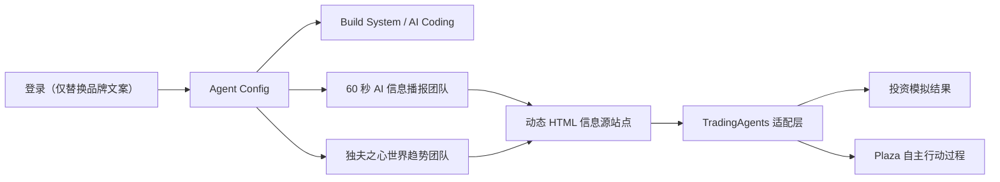

# StockAgents

StockAgents 是一个以 Agent 团队为核心的市场情报与股票投资模拟平台。项目复用现有 AgentsGroup2026 的团队配置、任务执行、记忆、技能、工具、Plaza 和数字员工基础设施，并在此之上增加可插拔信息源、两支内容团队，以及 AI 原生的多 Agent 投资分析流程。

> 当前状态：重构开发期。原有系统位于 `src/` 并可运行；两支新团队、信息源站点和 TradingAgents 适配层正在按 [TODOS.md](TODOS.md) 实施。文档不会把规划功能标记为已完成。

## 产品流程



登录、注册、访客模式默认进入 Agent Config。Build System、AI Coding 和 Plaza 均为必须保留的既有能力；第三方投资运行时不可用时，不得阻止这些能力启动。

## 目标团队

| 团队 | 状态 | 交付物 |
| --- | --- | --- |
| `build_system` | 既有，必须保留 | 构建系统任务 |
| `ai_coding` | 既有，必须保留 | AI 编码协作任务 |
| `ai_news_60s` | 待实现 | 高密度 AI 快讯动态 HTML |
| `dufu_world_intel` | 待实现 | 世界趋势采集、分析和动态数据 HTML |

两支内容团队参考公开内容的栏目节奏和分析结构，不复制创作者的声音、形象、口头禅或原文。所有事实性内容必须保留来源、时间戳、运行 ID 和不确定性说明。

## 投资分析运行时

主适配目标为 [TauricResearch/TradingAgents v0.3.1](https://github.com/TauricResearch/TradingAgents/releases/tag/v0.3.1)，固定到 tag `v0.3.1` / commit `01477f9`。项目将通过防腐层映射信息包、分析结果、辩论记录、风险意见和模拟决策，不直接侵入现有 Agent 内核。

框架接入仍处于规划阶段；当前仓库未声称能够执行真实交易。所有交易输出均为研究和模拟用途，不构成投资建议。

## 快速开始

环境要求：Python 3.11+、Node.js 20+。

```bash
python3 -m venv .venv
source .venv/bin/activate
python -m pip install -e '.[dev]'
cp .env.example .env

cd src/backend
python main.py --port 8080
```

浏览器打开 `http://127.0.0.1:8080/login.html`。开发环境如需默认管理员，先阅读 `.env.example` 中的安全说明。

前端测试依赖独立安装：

```bash
npm ci
npm run test:frontend
```

后端测试：

```bash
python -m pytest
```

常用命令也收录在 `Makefile` 中。

## 仓库导航

```text
StockAgents/
├── .github/                    GitHub Actions、Issue 与 PR 模板
├── docs/                       架构、开发、团队、信息源和集成文档
├── scripts/                    后续自动化脚本入口
├── src/
│   ├── backend/                FastAPI、Agent 内核、运行时和测试
│   │   ├── domain/             新领域模型边界
│   │   └── integrations/       第三方框架适配层
│   ├── frontend/               静态页面、JavaScript 和前端测试
│   └── storage/                现有样例/状态数据（提交前检查敏感信息）
├── PLAN.md                     已确认的重构设计
├── TODOS.md                    开发任务、伪代码和职责分工
└── pyproject.toml              Python 项目与测试配置
```

更完整的目录职责见 [docs/repository-layout.md](docs/repository-layout.md)，系统设计见 [docs/architecture.md](docs/architecture.md)。

## 开发约束

- 不移动现有 `src/backend` 与 `src/frontend`，先通过适配层渐进重构。
- 不绕过 Agent Config 创建隐藏模型配置；密钥只允许使用环境变量引用。
- 不破坏登录认证、Build System、AI Coding 或 Plaza 的加载路径。
- 信息源必须可插拔，并具备超时、大小限制、SSRF 防护和来源追踪。
- 投资模拟必须使用当时可见信息，禁止未来数据泄漏。

开始贡献前请阅读 [CONTRIBUTING.md](CONTRIBUTING.md) 和 [SECURITY.md](SECURITY.md)。详细规划以 [PLAN.md](PLAN.md) 为准，执行顺序以 [TODOS.md](TODOS.md) 为准。

## 许可证

本仓库尚未由维护者选定项目许可证。在许可证明确前，默认保留全部权利；第三方组件继续遵循各自许可证。计划集成的 TradingAgents 使用 Apache-2.0，详见 [THIRD_PARTY_NOTICES.md](THIRD_PARTY_NOTICES.md)。
