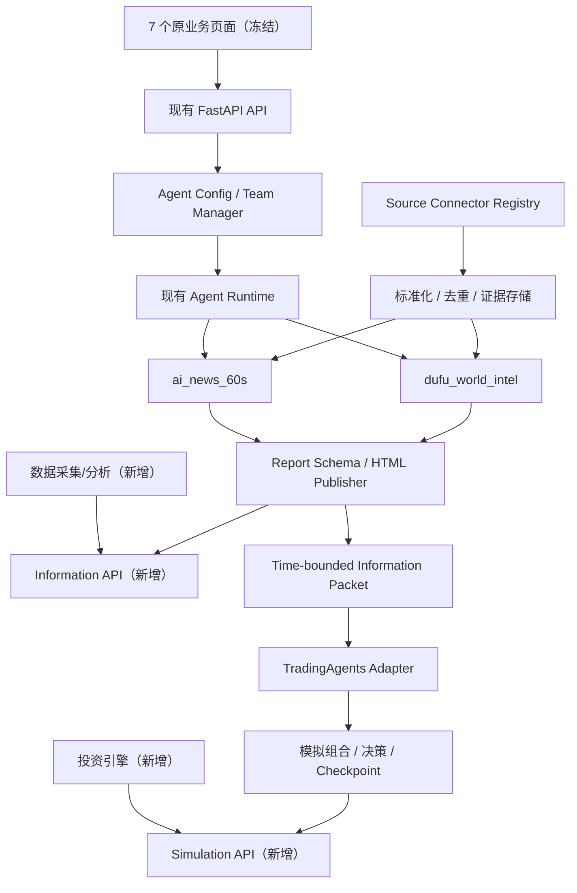

# 系统架构

## 设计原则

1. 保护现有系统：7 个原业务页面及其后台、Build System 和 AI Coding 是冻结基线。
2. 渐进适配：新领域模块不要求一次性搬迁旧代码。
3. 证据优先：信息内容和投资判断必须能回到来源与决策时点。
4. 可降级：TradingAgents 或单一来源失败时，其余受支持团队继续运行。
5. 仅做模拟：不内置真实券商下单通道。

## 逻辑组件



## 分层职责

- `agents/`：现有团队、工具、技能、记忆和调度行为；已有功能保持兼容。
- `domain/information_sources/`：来源定义、抓取批次、证据、游标和发布报告等领域契约。
- `domain/investment_simulation/`：模拟运行、信息快照、订单意图、组合状态和结果。
- `integrations/tradingagents/`：第三方图状态与 StockAgents 领域对象之间的转换。
- `frontend/js/features/data-intelligence/`：唯一的数据采集/分析新页面模块。
- `frontend/js/features/investment-engine/`：唯一的投资引擎新页面模块。
- 7 个原页面及其脚本不迁移、不顺手重构，也不接入新模拟事件。

## 关键数据契约

```text
SourceConfig
  → FetchBatch(raw items, cursor, observed_at)
  → EvidenceRecord(source, url, hash, fetched_at)
  → InformationPacket(as_of, claims, evidence, confidence)
  → SimulationRun(run_id, symbol, as_of, config_snapshot)
  → DecisionRecord(action, rationale, debates, risk, provenance)
```

`as_of` 是硬边界：connector、报告团队和投资 runtime 均不得读取该时刻之后才可见的信息。

## 降级矩阵

| 故障 | 行为 |
| --- | --- |
| 单一信息源失败 | 标记来源失败，其他来源继续 |
| 某支新团队失败 | 保存运行记录，另一团队和原团队继续 |
| HTML 发布失败 | 保留结构化报告，可重试发布 |
| TradingAgents 缺失/启动失败 | 7 个原页面和数据采集/分析页面继续可用 |
| 投资引擎页面不可用 | 返回可操作错误；不得把故障或未完成功能转嫁给 Plaza |
