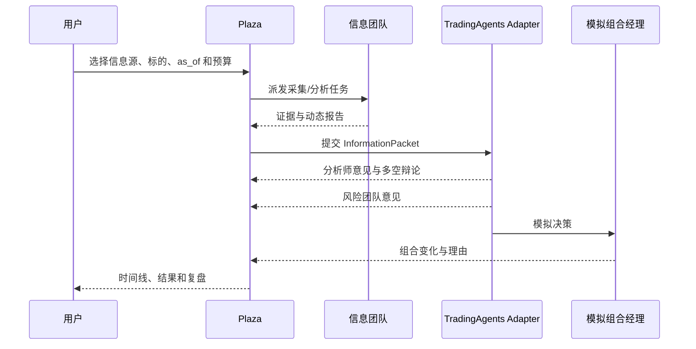

# Plaza 投资模拟

Plaza 保持原页面和现有交互能力。投资模拟把一次运行映射为可观察的 Agent 行动，而不是用新的空白页面取代 Plaza。

## 事件序列

## UI 原则

- 专用模拟页可以提供拖放信息源画布，但 Plaza 始终保留完整运行时间线。
- 拖放只改变当前草稿，保存后才形成不可变的 run config snapshot。
- 每个节点显示状态、耗时、成本、使用来源和失败原因。
- 结论区域同时展示支持证据、反证、风险和置信度。
- 任何收益曲线都标记为模拟结果，并显示费用、滑点与数据截止时间。
