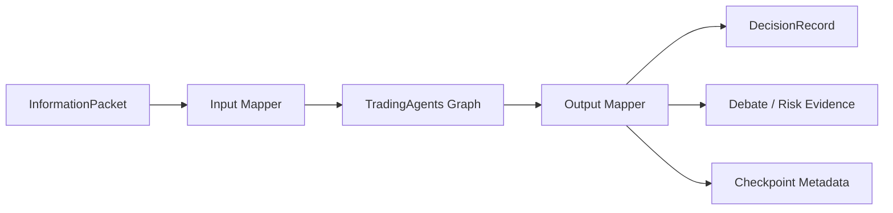

# TradingAgents 集成

## 固定版本

集成目标固定为 TauricResearch/TradingAgents `v0.3.1`，commit `01477f9`。Python extra 名为 `trading`，默认安装不拉取第三方运行时，确保原平台可独立启动。

## Adapter 边界

StockAgents API、数据库和页面不得直接序列化上游内部 state。Adapter 负责：

- 模型/Provider 配置映射；
- Market、Social、News、Fundamentals analyst 输入；
- Bull/Bear 和风险辩论事件转换；
- Portfolio Manager 决策转换；
- checkpoint、错误、成本和重试信息归一化。

## 强制保护

- `as_of` 决策时间之后的数据不可进入图。
- 每次运行保存 adapter 版本、上游 commit、模型配置和来源快照。
- 默认只生成模拟决策，不暴露真实交易执行接口。
- 上游导入失败返回 `trading_runtime=unavailable`，不能中止核心应用。

升级上游版本必须新建 ADR，并对同一 fixture 做结果结构与时序泄漏回归。
