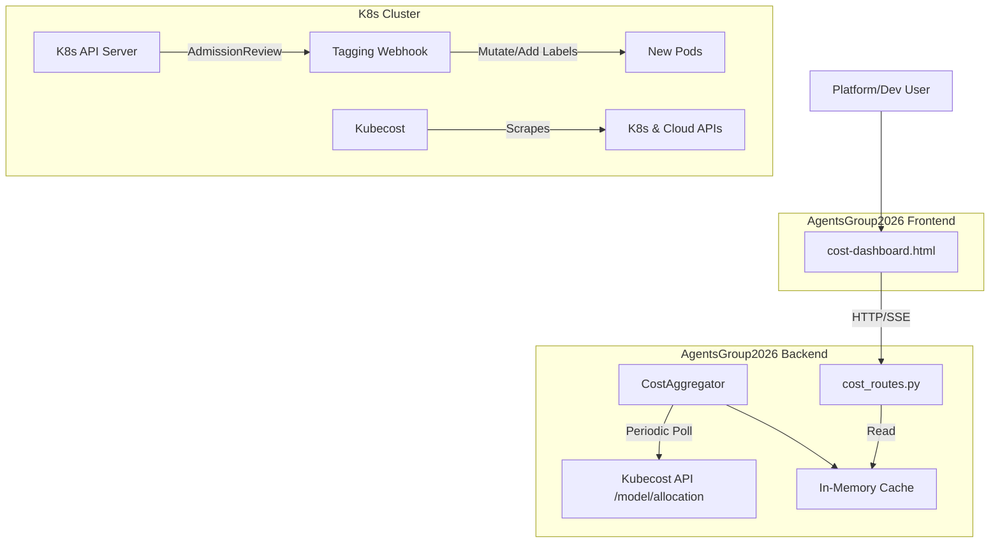

# 架构设计 — architect

任务: 集成OpenCost，实现K8s Pod/微服务级成本标签自动化注入与Dashboard可视化
步骤: architecture
Agent: build_architect

---

📋 任务: c4193a58-784
🤖 Agent: Architect (architect)
📂 工作目录: /Users/panglaohu/Downloads/AgentsGroup2026
🔧 执行方式: DeepSeek API (直连)
⏱️ 超时: 1200s
────────────────────────────────────────────────────────────
📝 提示词:
  你是 AgentsGroup2026 系统的 Architect (architect)。
  请执行以下开发任务:
  
  你是系统架构师。请为以下任务设计技术方案:
  
  ## 任务
  集成OpenCost，实现K8s Pod/微服务级成本标签自动化注入与Dashboard可视化
  负责角色: 全栈开发、自动化与平台工程师
  依赖: 无
  预期产出: 实时成本监控Dashboard，支持按服务/环境维度查询
  负责角色: 全栈开发、自动化与平台工程师
  依赖: 无
  预期产出: 实时成本监控Dashboard，支持按服务/环境维度查询
  
  ## 📂 项目上下文 (系统自动预加载)
  
  ### 项目文件结构 (src/ 目录)
  ```
  src/frontend/agent-team-config.html
  src/frontend/datacenter-ratchet-evolution.html
  src/frontend/digital-twin-cli.html
  src/frontend/extraction-pipeline.html
  src/frontend/index.html
  src/frontend/login.html
  src/frontend/plaza.html
  src/frontend/sandbox-twin.html
  src/frontend/skill-extract.html
  src/frontend/system-evolution.html
  src/frontend/tasks.html
  src/frontend/css/agent-team-config.css
  src/frontend/css/openbridge-theme.css
  src/frontend/css/skill-extract-timeline.css
  src/frontend/css/skill-extract.css
  src/frontend/css/variables.css
  src/frontend/css/ws-theme-bridge.css
  src/frontend/js/agent-detail.js
  src/frontend/js/agent-team-config.js
  src/frontend/js/api.js
  src/frontend/js/digital-twin-cli-3d.js
  src/frontend/js/digital-twin-cli.js
  src/frontend/js/global-nav.js
  src/frontend/js/i18n.js
  src/frontend/js/nav-sidebar.js
  src/frontend/js/plaza.js
  src/frontend/js/sandbox-twin.js
  src/frontend/js/sessions-runtime.js
  src/frontend/js/skill-extract-timeline.js
  src/frontend/js/skill-extract.js
  src/frontend/js/system-evolution.js
  src/frontend/js/tasks-view.js
  src/frontend/js/token-factory.js
  src/frontend/js/tools-skills.js
  src/frontend/js/utils.js
  src/frontend/js/wizard.js
  src/backend/__init__.py
  src/backend/agent_team_api.py
  src/backend/config.py
  src/backend/main.py
  src/backend/main.py.bak
  src/backend/server.log
  src/backend/startup_check.py
  src/backend/startup_validator.py
  src/backend/tests/__init__.py
  src/backend/tests/conftest.py
  src/backend/tests/conftest.py.bak
  src/backend/tests/test_ab_testing.py
  src/backend/tests/test_agent_skill_binding.py
  src/backend/tests/test_agent_toolbox.py
  src/backend/tests/test_evolution_race.py
  src/backend/tests/test_evolution_race.py.bak
  src/backend/tests/test_fingerprint.py
  src/backend/tests/test_fingerprint.py.bak
  src/backend/tests/test_gate_evaluator.py
  src/backend/tests/test_gate_evaluator.py.bak
  src/backend/tests/test_main_health.py
  src/backend/tests/test_merge_plugin.py
  src/backend/tests/test_merge_plugin.py.bak
  src/backend/tests/test_models.py
  src/backend/tests/test_models.py.bak
  src/backend/tests/test_operation_store.py
  src/backend/tests/test_permissions_and_secrets.py
  src/backend/tests/test_plan_loop_runtime.py
  src/backend/tests/test_plaza_dispatch.py
  src/backend/tests/test_plaza_evolution_bridge.py
  src/backend/tests/test_plaza_task_artifact_bridge.py
  src/backend/tests/test_qa_gate_pipeline.py
  src/backend/tests/test_qa_gate_pipeline.py.bak
  src/backend/tests/test_review_integration.py
  src/backend/tests/test_review_integration.py.bak
  src/backend/tests/test_sandbox_security.py
  src/backend/tests/test_task_engine.py
  src/backend/tests/test_task_engine.py.bak
  src/backend/tests/test_team_manager.py
  src/backend/tests/test_team_manager.py.bak
  src/backend/tests/test_template_variants.py
  src/backend/tests/test_template_variants.py.bak
  src/backend/tests/test_token_budget.py
  src/backend/tests/test_unified_tool_loop.py
  src/backend/agents/__init__.py
  src/backend/agents/ab_testing.py
  src/backend/agents/agent_loop.py
  src/backend/agents/agent_toolbox.py
  src/backend/agents/api.py
  src/backend/agents/api.py.bak
  src/backend/agents/audit_store.py
  src/backend/agents/chat_harness.py
  src/backend/agents/domain_events.py
  src/backend/agents/domain_events.py.bak
  src/backend/agents/event_bus.py
  src/backend/agents/execution_registry.py
  src/backend/agents/extraction_models.py
  src/backend/agents/extraction_pipeline.py
  src/backend/agents/extraction_pipeline.py.bak
  src/backend/agents/extraction_routes.py
  src/backend/agents/extraction_store.py
  src/backend/agents/fingerprint.py
  src/backend/agents/fingerprint.py.bak
  src/backend/agents/gate_evaluator.py
  src/backend/agents/hermes_research.py
  src/backend/agents/knowledge_base.py
  src/backend/agents/merge_engine.py
  src/backend/agents/merge_models.py
  src/backend/agents/models.py
  src/backend/agents/models.py.bak
  src/backend/agents/operation_api.py
  src/backend/agents/operation_models.py
  src/backend/agents/operation_store.py
  src/backend/agents/plaza.py
  src/backend/agents/plaza.py.bak
  src/backend/agents/plaza_engine.py
  src/backend/agents/plaza_routes.py
  src/backend/agents/plaza_routes.py.bak
  src/backend/agents/plaza_store.py
  src/backend/agents/review_models.py
  src/backend/agents/review_routes.py
  src/backend/agents/review_service.py
  src/backend/agents/secret_store.py
  src/backend/agents/session_store.py
  src/backend/agents/similarity_engine.py
  src/backend/agents/skill_evolver.py
  src/backend/agents/skill_extract_ws.py
  src/backend/agents/skill_extractor.py
  src/backend/agents/skill_indexer.py
  src/backend/agents/skill_library.py
  src/backend/agents/skill_querier.py
  src/backend/agents/skill_registry.py
  src/backend/agents/skill_router.py
  src/backend/agents/skill_router_routes.py
  src/backend/agents/skill_store.py
  src/backend/agents/skill_tracker.py
  src/backend/agents/skill_verifier.py
  src/backend/agents/task_engine.py
  src/backend/agents/task_engine.py.bak
  src/backend/agents/task_store.py
  src/backend/agents/team_manager.py
  src/backend/agents/team_manager.py.bak
  src/backend/agents/team_store.py
  src/backend/agents/tool_executor.py
  src/backend/agents/tool_registry.py
  src/backend/agents/trajectory_analyzer.py
  src/backend/agents/tts_routes.py
  src/backend/agents/security/__init__.py
  src/backend/agents/security/permission_resolver.py
  src/backend/agents/runtime/__init__.py
  src/backend/agents/runtime/events.py
  src/backend/agents/runtime/plan_loop.py
  src/backend/agents/runtime/tool_loop.py
  src/backend/agents/evolution/__init__.py
  ... (共 966 个 src/ 文件)
  
  ```
  
  ### 文件: `src/frontend/js/wizard.js`
  ```js
  /**
   * AgentsGroup2026 — New Agent Creation Wizard
   * Multi-step wizard for creating new agents with personality,
   * skills, tools, and permissions configuration.
   * Extracted from agent-team-config.js for modularity.
   * Depends on: utils.js, api.js, agent-team-config.js (parent scope)
   */
  (function(){
  'use strict';
  const TMPLS=[{id:'custom',ab:'自定义',nm:'自定义'},{id:'coordinator',ab:'PM',nm:'项目经理'},{id:'researcher',ab:'RS',nm:'研究员'},{id:'developer',ab:'DV',nm:'开发者'},{id:'analyst',ab:'AN',nm:'分析师'},{id:'navigator',ab:'NV',nm:'导航员'},{id:'engineer',ab:'EN',nm:'工程师'}];
  
  function openWizard(){wzD={template_type:'custom',name:'',role:'',description:'',system_prompt:'',model_id:'',team_id:tid,personality:{tone:'professional',language:'zh-CN',expertise_areas:[],response_style:'concise',creativity:0.5},skill_ids:[],tool_ids:[],permissions:[],channels:[],visibility:'public',default_access:'use'};wzS=1;switchView('wizard');renderWz()}
  
  function renderWz(){
    document.querySelectorAll('#wz-steps .wz-step').forEach(s=>{const n=+s.dataset.step;s.classList.remove('active','done');if(n===wzS)s.classList.add('active');else if(n<wzS)s.classList.add('done')});
    const c=el('wz-content'),w=wzD;
    if(wzS===1){
      c.innerHTML=`<h3 style="margin-bottom:20px">基础信息与模型选择</h3><p class="form-label" style="margin-bottom:10px">选择模板（可选）</p><div class="tmpl-grid">${TMPLS.map(t=>`<div class="tmpl-card${w.template_type===t.id?' selected':''}" onclick="selTmpl('${t.id}')"><div class="abbr">${t.ab}</div><div class="desc">${t.nm}</div></div>`).join('')}</div><div style="display:flex;gap:12px;margin-bottom:16px"><p style="color:var(--muted);font-size:12px;cursor:pointer" onclick="toast('JSON 导入功能开发中')">↑ 从 JSON 导入</p><p style="color:var(--pink);font-size:12px;cursor:pointer;font-weight:600" onclick="openModal('modal-import-openclaw')">🔗 连接 OpenClaw Agent</p></div><div class="form-group"><label class="form-label">名称 <span class="req">*</span></label><input class="fi" id="wz-name" value="${w.name}" placeholder="例：小智"></div><div class="form-group"><label class="form-label">👤 角色</label><input class="fi" id="wz-role" value="${w.role}" placeholder="描述它的角色定位"></div><div class="form-group"><label class="form-label">描述</label><textarea class="fi" id="wz-desc">${w.description}</textarea></div><div class="form-group"><label class="form-label">所属团队 <span class="req">*</span></label><select class="fi" id="wz-team"></select></div><div class="form-group"><label class="form-label">主模型 <span class="req">*</span></label><select class="fi" id="wz-model"><option value="">选择模型...</option></select></div><div class="wz-actions"><button class="btn" onclick="switchView('overview')">取消</button><button class="btn btn-pink" onclick="wzNext()">下一步 →</button></div>`;
      api(`${A}/teams`).then(ts=>{const s=el('wz-team');if(ts)ts.forEach(t=>{const o=document.createElement('option');o.value=t.team_id;o.textContent=t.name;if(t.team_id===(w.team_id||tid))o.selected=true;s.appendChild(o)})});
      api(`${A}/teams/${w.team_id||tid}/models`).then(ms=>{const s=el('wz-model');if(ms)ms.forEach(m=>{const o=document.createElement('option');o.value=m.model_id;o.textContent=`${m.name} (${m.provider})`;if(m.model_id===w.model_id)o.selected=true;s.appendChild(o)})});
    } else if(wzS===2){
      c.innerHTML=`<h3 style="margin-bottom:20px">人格设定</h3><div class="form-group"><label class="form-label">语言风格</label><select class="fi" id="wz-tone"><option value="professional"${w.personality.tone==='professional'?' selected':''}>专业</option><option value="friendly"${w.personality.tone==='friendly'?' selected':''}>友好</option><option value="directive"${w.personality.tone==='directive'?' selected':''}>指令式</option><option value="casual"${w.personality.tone==='casual'?' selected':''}>随意</option></select></div><div class="form-group"><label class="form-label">语言</label><select class="fi" id="wz-lang"><option value="zh-CN"${w.personality.language==='zh-CN'?' selected':''}>中文</option><option value="en"${w.personality.language==='en'?' selected':''}>English</option></select></div><div class="form-group"><label class="form-label">回复风格</label><select class="fi" id="wz-style"><option value="concise"${w.personality.response_style==='concise'?' selected':''}>简洁</option><option value="detailed"${w.personality.response_style==='detailed'?' selected':''}>详细</option><option value="structured"${w.personality.response_style==='structured'?' selected':''}>结构化</option></select></div><div class="form-group"><label class="form-label">创造力 (${w.personality.creativity})</label><input type="range" id="wz-creat" min="0" max="1" step="0.1" value="${w.personality.creativity}"></div><div class="form-group"><label class="form-label">专长领域</label><div>${(w.personality.expertise_areas||[]).map(e=>`<span class="chip">${e} <span class="x" onclick="rmExp('${e}')">×</span></span>`).join('')}<span class="chip chip-add" onclick="addExp()">＋ 添加</span></div></div><div class="form-group"><label class="form-label">系统提示词</label><textarea class="fi" id="wz-prompt" rows="4" placeholder="定义核心行为...">${w.system_prompt||''}</textarea></div><div class="wz-actions"><button class="btn" onclick="wzBack()">← 上一步</button><button class="btn btn-pink" onclick="wzNext()">下一步 →</button></div>`;
    } else if(wzS===3){
      api(`${A}/skills`).then(sk=>{
        const cats={};(sk||[]).forEach(s=>{const c=s.category||'general';if(!cats[c])cats[c]=[];cats[c].push(s)});
        let html='<h3 style="margin-bottom:20px">技能配置</h3><p style="color:var(--muted);font-size:13px;margin-bottom:16px">选择此 Agent 应具备的技能 <span style="color:var(--pink)">('+w.skill_ids.length+' 已选)</span></p>';
        Object.keys(cats).sort().forEach(cat=>{html+=`<div class="sb-section" style="margin-top:14px;margin-bottom:8px">${cat.toUpperCase()}</div>`;cats[cat].forEach(s=>{const on=w.skill_ids.includes(s.skill_id);html+=`<div class="ws-item" style="cursor:pointer" onclick="togWzSk('${s.skill_id}')"><span class="fname"><span style="font-size:16px">${on?'☑':'☐'}</span> ${s.icon||'⚡'} ${s.name}</span><span style="color:var(--dim);font-size:12px">${s.category||''}</span></div>`})});
        html+=`<div class="wz-actions"><button class="btn" onclick="wzBack()">← 上一步</button><button class="btn btn-pink" onclick="wzNext()">下一步 →</button></div>`;
        c.innerHTML=html});
    } else if(wzS===4){
      api(`${A}/tools`).then(tk=>{
        const cats={};(tk||[]).forEach(t=>{const c=t.category||'general';if(!cats[c])cats[c]=[];cats[c].push(t)});
        let html='<h3 style="margin-bottom:20px">工具绑定</h3><p style="color:var(--muted);font-size:13px;margin-bottom:16px">选择要绑定的工具 <span style="color:var(--pink)">('+w.tool_ids.length+' 已选)</span></p>';
        Object.keys(cats).sort().forEach(cat=>{html+=`<div class="sb-section" style="margin-top:14px;margin-bottom:8px">${cat.toUpperCase()}</div>`;cats[cat].forEach(t=>{const on=w.tool_ids.includes(t.tool_id);html+=`<div class="ws-item" style="cursor:pointer" onclick="togWzTk('${t.tool_id}')"><span class="fname"><span style="font-size:16px">${on?'☑':'☐'}</span> ${t.icon||'🔧'} ${t.name}</span><span style="display:flex;align-items:center;gap:8px"><span style="color:var(--dim);font-size:12px">${t.category||''}</span>${t.is_default?'<span class="chip" style="background:rgba(152,245,167,0.12);color:var(--lime);font-size:10px">Default</span>':''}</span></div>`})});
        html+=`<div class="wz-actions"><button class="btn" onclick="wzBack()">← 上一步</button><button class="btn btn-pink" onclick="wzNext()">下一步 →</button></div>`;
        c.innerHTML=html});
    } else if(wzS===5){
      c.innerHTML=`<h3 style="margin-bottom:20px">权限设置</h3><div class="section"><div class="section-title">可见范围</div><div style="display:flex;flex-direction:column;gap:10px;margin-bottom:24px"><div class="tmpl-card${w.visibility==='public'?' selected':''}" onclick="setWzVis('public')" style="text-align:left;padding:16px;display:flex;align-items:center;gap:12px"><span style="color:var(--pink);font-size:20px">${w.visibility==='public'?'●':'○'}</span><div><div style="font-weight:600">全公司可见</div><div style="font-size:12px;color:var(--muted)">所有人都可以使用此数字员工</div></div></div><div class="tmpl-card${w.visibility==='private'?' selected':''}" onclick="setWzVis('private')" style="text-align:left;padding:16px;display:flex;align-items:center;gap:12px"><span style="color:var(--dim);font-size:20px">${w.visibility==='private'?'●':'○'}</span><div><div style="font-weight:600">仅自己</div><div style="font-size:12px;color:var(--muted)">仅创建者本人可使用</div></div></div></div></div><div class="section"><div class="section-title">默认访问级别</div><div style="display:grid;grid-template-columns:1fr 1fr;gap:12px;margin-bottom:24px"><div class="tmpl-card${w.default_access==='use'?' selected':''}" onclick="setWzAccess('use')" style="text-align:left;padding:16px"><div style="display:flex;align-items:center;gap:8px"><span style="color:var(--pink);font-size:16px">${w.default_access==='use'?'●':'○'}</span><span style="font-size:18px">⚙️</span><div style="font-weight:600">使用</div></div><div style="font-size:12px;color:var(--muted);margin-top:6px">可以使用任务、聊天、工具、技能、工作区</div></div><div class="tmpl-card${w.default_access==='admin'?' selected':''}" onclick="setWzAccess('admin')" style="text-align:left;padding:16px"><div style="display:flex;align-items:center;gap:8px"><span style="color:var(--dim);font-size:16px">${w.default_access==='admin'?'●':'○'}</span><span style="font-size:18px">⚙️</span><div style="font-weight:600">管理</div></div><div style="font-size:12px;color:var(--muted);margin-top:6px">完全访问权限，包括设置、心智、关系</div></div></div></div><div class="section"><div class="section-title">细粒度权限 <span style="font-size:12px;color:var(--muted);font-weight:400">（可选）</span></div><div id="wz-perms">${(w.permissions||[]).map((p,i)=>`<div class="ws-item"><span class="fname">${p.resource} — ${p.access_level}</span><button class="btn btn-danger btn-sm" style="padding:2px 8px" onclick="rmPerm(${i})">×</button></div>`).join('')}</div><div style="display:grid;grid-template-columns:1fr 1fr;gap:10px;margin-top:12px"><input class="fi" id="wz-pr" placeholder="资源名"><select class="fi" id="wz-pl"><option value="read">只读</option><option value="write">读写</option><option value="admin">管理</option></select></div><button class="btn btn-sm" style="margin-top:8px" onclick="addPerm()">＋ 添加</button></div><div class="wz-actions"><button class="btn" onclick="wzBack()">← 上一步</button><button class="btn btn-pink" onclick="wzNext()">下一步 →</button></div>`;
    } else if(wzS===6){
      const CH_PLATFORMS=[{id:'slack',icon:'💬',name:'Slack',desc:'Slack Bot'},{id:'discord',icon:'🎮',name:'Discord',desc:'Gateway / Webhook'},{id:'teams',icon:'🟦',name:'Microsoft Teams',desc:'Teams Bot'},{id:'feishu',icon:'💙',name:'飞书机器人',desc:'Feishu / Lark'},{id:'wecom',icon:'💚',name:'企业微信',desc:'WebSocket / Webhook'},{id:'dingtalk',icon:'🔵',name:'钉钉',desc:'Stream Mode'},{id:'atlassian',icon:'🔺',name:'Atlassian',desc:'Jira / Confluence / Compass (Rovo MCP)'},{id:'agentbay',icon:'☁️',name:'AgentBay',desc:'Browser & Code Execution (阿里云)'}];
      const chMap={};(w.channels||[]).forEach(ch=>chMap[ch.channel_name]=ch);
      let html=`<h3 style="margin-bottom:20px">通道配置</h3><p style="color:var(--muted);font-size:13px;margin-bottom:20px">连接消息平台，使你的智能体能够通过不同的渠道进行通信。</p>`;
      CH_PLATFORMS.forEach(p=>{const on=!!chMap[p.id];html+=`<div class="ws-item" style="cursor:pointer;padding:16px;margin-bottom:8px" onclick="togWzChan('${p.id}','${p.name}')"><span class="fname"><span style="font-size:22px">${p.icon}</span><div><div style="font-weight:600">${p.name}</div><div style="font-size:12px;color:var(--muted)">${p.desc}</div></div></span><span style="font-size:14px;color:${on?'var(--pink)':'var(--dim)'}">${on?'▼':'▶'}</span></div>`;if(on){html+=`<div style="padding:4px 16px 12px;margin-top:-8px;margin-bottom:8px;border:1px solid var(--line);border-top:none;border-radius:0 0 8px 8px;background:rgba(232,240,250,0.5)"><div style="display:grid;grid-template-columns:1fr 1fr;gap:10px"><label style="display:flex;align-items:center;gap:6px;font-size:13px"><input type="checkbox" role="switch" ${chMap[p.id].subscribe?'checked':''} onchange="updChanSub('${p.id}',this.checked)"> 订阅</label><label style="display:flex;align-items:center;gap:6px;font-size:13px"><input type="checkbox" role="switch" ${chMap[p.id].publish?'checked':''} onchange="updChanPub('${p.id}',this.checked)"> 发布</label></div></div>`}});
      html+=`<p style="color:var(--muted);font-size:12px;text-align:center;margin-top:16px">跳过此步骤后，数字员工仍可通过 Web 端进行对话</p>`;
      html+=`<div style="background:var(--panel2);border:1px solid var(--line);border-radius:0;padding:14px;margin-top:20px;font-size:13px;color:var(--muted)">${w.name||'未命名'} · 模型: ${w.model_id||'未选择'}</div>`;
      html+=`<div class="wz-actions"><button class="btn" onclick="wzBack()">← 上一步</button><button class="btn btn-pink" onclick="wzFinish()">🚀 完成创建</button></div>`;
      c.innerHTML=html;
    }
  }
  
  const TMPL_DEFAULTS={
    coordinator:{role:'项目协调与任务分配',personality:{tone:'directive',response_style:'structured',expertise_areas:['项目管理','任务拆解','进度跟踪']},skill_ids:['task_decomposition','progress_tracking','blocker_resolution']},
    researcher:{role:'深度研究与知识发现',personality:{tone:'professional',response_style:'detailed',expertise_areas:['文献检索','数据分析','知识整理'],creativity:0.7},skill_ids:['web_research','data_analysis','cross_session_recall'],tool_ids:['web_search','extract_content','memory_read']},
    developer:{role:'代码开发与技术实现',personality:{tone:'professional',response_style:'concise',expertise_areas:['编程','调试','架构设计']},skill_ids:['code_implementation','debugging','refactoring'],tool_ids:['run_shell','read_file','write_file']},
    analyst:{role:'数据分析与洞察挖掘',personality:{tone:'professional',response_style:'structured',expertise_areas:['数据可视化','统计分析','趋势预测'],creativity:0.6},skill_ids:['data_analysis','competitive_analysis','requirements_analysis'],tool_ids:['run_python','read_file','web_search']},
    navigator:{role:'航线规划与海况分析',personality:{tone:'directive',response_style:'concise',expertise_areas:['航海','气象','避碰']},skill_ids:['web_research','requirements_analysis','progress_tracking'],tool_ids:['web_search','extract_content','read_file']},
    engineer:{role:'机舱监控与设备维护',personality:{tone:'professional',response_style:'structured',expertise_areas:['轮机','传感器','预测维护']},skill_ids:['debugging','data_analysis','build_automation'],tool_ids:['run_shell','read_file','write_file']}
  };
  function selTmpl(id){
    wzD.template_type=id;
    const def=TMPL_DEFAULTS[id];
    if(def){
      if(def.role&&!wzD.role)wzD.role=def.role;
      if(def.personality)Object.assign(wzD.personality,def.personality);
      if(def.skill_ids)wzD.skill_ids=[...new Set([...wzD.skill_ids,...def.skill_ids])];
      if(def.tool_ids)wzD.tool_ids=[...new Set([...wzD.tool_ids,...def.tool_ids])];
    }
    renderWz();
  }
  function wzBack(){if(wzS>1){saveWzData();wzS--;renderWz()}}
  function wzNext(){
    saveWzData();
    // Validate step 1 required fields
    if(wzS===1){
      if(!wzD.name){toast('请填写 Agent 名称','error');el('wz-name')?.focus();return}
      if(
  ```
  
  ### 文件: `src/backend/tests/test_plaza_dispatch.py`
  ```py
  # -*- coding: utf-8 -*-
  """Plaza discussion dispatch tests."""
  
  from __future__ import annotations
  
  from pathlib import Path
  from tempfile import TemporaryDirectory
  
  import pytest
  
  from agents import api as api_module
  from agents import plaza_engine as plaza_engine_module
  from agents import plaza_routes
  from agents import task_engine as task_engine_module
  from agents.plaza_engine import PlazaEngine
  from agents.plaza_store import PlazaStore
  from agents.task_engine import AgentTask, TaskEngine
  from agents.task_store import TaskStore
  
  
  @pytest.fixture
  def isolated_plaza_engine(monkeypatch):
      with TemporaryDirectory() as tmpdir:
          engine = PlazaEngine()
          engine._store = PlazaStore(base_dir=Path(tmpdir))
          engine._plazas = {}
          monkeypatch.setattr(plaza_engine_module, "_engine", engine)
          yield engine
  
  
  @pytest.fixture
  def isolated_task_engine(monkeypatch):
      with TemporaryDirectory() as tmpdir:
          engine = TaskEngine(store=TaskStore(base_dir=Path(tmpdir)))
          monkeypatch.setattr(task_engine_module, "_engine", engine)
          yield engine
  
  
  def _build_plan_text() -> str:
      return (
          "## 执行计划\n"
          "| 序号 | 任务 | 负责角色 | 优先级 | 依赖 | 预期产出 |\n"
          "|---|---|---|---|---|---|\n"
          "| 1 | 修复启动链路 | developer | P0 | 无 | 启动补丁 |\n"
          "| 2 | 补回归测试 | qa | P1 | 1 | pytest 报告 |\n"
      )
  
  
  def _seed_discussion(engine: PlazaEngine):
      plaza = engine.create_plaza("测试广场", "dispatch")
      disc = engine.create_discussion(plaza.id, "让 Plaza 真的能派发任务", "dispatch", "", 3)
      disc.plan = {
          "revision": 3,
          "revision_reason": "测试计划",
          "revised_at": "2026-05-29T00:00:00+00:00",
          "content": _build_plan_text(),
      }
      engine._store.save_plaza(plaza)
      return plaza, disc
  
  
  class TestPlanParsing:
      def test_parse_markdown_plan_table(self):
          tasks = plaza_routes._parse_plan_table(_build_plan_text())
          assert len(tasks) == 2
          assert tasks[0]["title"] == "修复启动链路"
          assert tasks[0]["priority"] == 1
          assert tasks[0]["responsible"] == "developer"
          assert tasks[0]["expected_artifact"] == "启动补丁"
          assert tasks[1]["dependencies"] == "1"
  
  
  class TestDiscussionDispatch:
      @pytest.mark.asyncio
      async def test_dispatch_tasks_updates_discussion_plan(self, isolated_plaza_engine, monkeypatch):
          plaza, disc = _seed_discussion(isolated_plaza_engine)
          submitted = []
  
          async def fake_submit_internal_task(team_id: str, **kwargs):
              task = AgentTask(
                  task_id=f"task-{len(submitted) + 1}",
                  team_id=team_id,
                  title=kwargs["title"],
                  description=kwargs["description"],
                  priority=kwargs["priority"],
                  metadata=kwargs["metadata"],
              )
              submitted.append(task)
              return task
  
          monkeypatch.setattr(api_module, "_submit_internal_task", fake_submit_internal_task)
  
          result = await plaza_routes.dispatch_tasks_from_discussion(
              plaza.id,
              disc.id,
              plaza_routes.DispatchTasksRequest(team_id="team-build"),
          )
  
          assert result["status"] == "dispatched"
          assert result["task_count"] == 2
          assert [task["task_id"] for task in result["tasks"]] == ["task-1", "task-2"]
  
          updated_disc = isolated_plaza_engine.get_discussion(plaza.id, disc.id)
          assert updated_disc.assigned_team_id == "team-build"
          assert updated_disc.plan["task_ids"] == ["task-1", "task-2"]
          assert updated_disc.plan["task_count"] == 2
          assert updated_disc.plan["team_id"] == "team-build"
  
          first_metadata = result["tasks"][0]["metadata"]
          assert first_metadata["source"] == "plaza"
          assert first_metadata["discussion_id"] == disc.id
          assert first_metadata["plan_revision"] == 3
          assert first_metadata["plan_item_index"] == 0
          assert first_metadata["responsible_role"] == "developer"
          assert first_metadata["skills_used"] == ["code_implementation", "debugging"]
          assert first_metadata["trace_context"]["discussion_id"] == disc.id
          assert first_metadata["trace_context"]["plaza_id"] == plaza.id
          assert first_metadata["trace_context"]["plan_revision"] == 3
  
          second_metadata = result["tasks"][1]["metadata"]
          assert second_metadata["responsible_role"] == "qa"
          assert second_metadata["skills_used"] == ["testing", "test_execution", "regression_testing"]
  
          summary = await plaza_routes.get_discussion_summary(plaza.id, disc.id)
          assert summary["plan_revision"] == 3
          assert summary["task_ids"] == ["task-1", "task-2"]
          assert summary["task_count"] == 2
  
      @pytest.mark.asyncio
      async def test_get_discussion_tasks_returns_only_linked_tasks(
          self,
          isolated_plaza_engine,
          isolated_task_engine,
      ):
          plaza, disc = _seed_discussion(isolated_plaza_engine)
  
          await isolated_task_engine.submit_task(
              AgentTask(
                  task_id="task-2",
                  team_id="team-build",
                  title="第二个任务",
                  metadata={
                      "source": "plaza",
                      "plaza_id": plaza.id,
                      "discussion_id": disc.id,
                      "plan_item_index": 1,
                  },
              )
          )
          await isolated_task_engine.submit_task(
              AgentTask(
                  task_id="task-1",
                  team_id="team-build",
                  title="第一个任务",
                  metadata={
                      "source": "plaza",
                      "plaza_id": plaza.id,
                      "discussion_id": disc.id,
                      "plan_item_index": 0,
                  },
              )
          )
          await isolated_task_engine.submit_task(
              AgentTask(
                  task_id="task-x",
                  team_id="other",
                  title="无关任务",
                  metadata={
                      "source": "plaza",
                      "plaza_id": plaza.id,
                      "discussion_id": "other-discussion",
                      "plan_item_index": 0,
                  },
              )
          )
  
          result = await plaza_routes.get_discussion_tasks(plaza.id, disc.id)
          assert result["task_count"] == 2
          assert [task["task_id"] for task in result["tasks"]] == ["task-1", "task-2"]
  
  ```
  
  ### 文件: `src/backend/tests/test_plaza_evolution_bridge.py`
  ```py
  # -*- coding: utf-8 -*-
  """Plaza to evolution bridge tests."""
  
  from __future__ import annotations
  
  from pathlib import Path
  from tempfile import TemporaryDirectory
  
  import pytest
  
  import agent_team_api as agent_team_api_module
  from agents import api as api_module
  from agents import plaza_engine as plaza_engine_module
  from agents import task_engine as task_engine_module
  from channels.system_evolution import (
      EvolutionItem,
      EvolutionStatus,
      SystemEvolutionChannel,
  )
  from agents.plaza_engine import PlazaEngine
  from agents.plaza_routes import (
      EvolveRequest,
      evolve_from_discussion,
      get_discussion_verification_alerts,
      get_discussion_verification_queue,
      run_discussion_verification_queue,
  )
  from agents.plaza_store import PlazaStore
  from agents.task_engine import AgentTask, TaskEngine
  from agents.task_store import TaskStore
  
  
  @pytest.fixture
  def isolated_plaza_engine(monkeypatch):
      with TemporaryDirectory() as tmpdir:
          engine = PlazaEngine()
          engine._store = PlazaStore(base_dir=Path(tmpdir))
          engine._plazas = {}
          monkeypatch.setattr(plaza_engine_module, "_engine", engine)
          yield engine
  
  
  @pytest.fixture
  def isolated_task_engine(monkeypatch):
      with TemporaryDirectory() as tmpdir:
          engine = TaskEngine(store=TaskStore(base_dir=Path(tmpdir) / "tasks"))
          monkeypatch.setattr(task_engine_module, "_engine", engine)
          yield engine
  
  
  def _seed_discussion(engine: PlazaEngine):
      plaza = engine.create_plaza("演化广场", "evolution")
      disc = engine.create_discussion(plaza.id, "让 Plaza 接进 Evolution", "evolution", "", 3)
      disc.plan = {
          "revision": 2,
          "revision_reason": "测试演化桥接",
          "revised_at": "2026-05-29T00:00:00+00:00",
          "content": (
              "## 执行计划\n"
              "| 序号 | 任务 | 负责角色 | 优先级 | 依赖 | 预期产出 |\n"
              "|---|---|---|---|---|---|\n"
              "| 1 | 打通演化派发 | developer | P0 | 无 | 任务桥接补丁 |\n"
              "| 2 | 补充桥接测试 | qa | P1 | 1 | 回归测试报告 |\n"
          ),
      }
      engine._store.save_plaza(plaza)
      return plaza, disc
  
  
  class TestEvolutionCycleGuards:
      def test_run_evolution_cycle_does_not_auto_verify_dispatched_items(self):
          channel = SystemEvolutionChannel()
          channel.initialize()
          channel.audit_rules = []
  
          item = EvolutionItem(
              id="ev-dispatch-only",
              title="仅派发",
              description="不应自动进入验证",
          )
          channel.evolution_items[item.id] = item
  
          result = channel.run_evolution_cycle()
  
          assert result["dispatch"]["count"] == 1
          assert result["verify"]["count"] == 0
          assert channel.evolution_items[item.id].status == EvolutionStatus.DISPATCHED.value
  
      def test_mark_build_complete_requires_artifacts(self):
          channel = SystemEvolutionChannel()
          channel.initialize()
  
          item = EvolutionItem(
              id="ev-build-guard",
              title="需要真实产物",
              description="无产物不允许进入验证",
              status=EvolutionStatus.IN_PROGRESS.value,
          )
          channel.evolution_items[item.id] = item
  
          assert channel.mark_build_complete(item.id) is False
          assert channel.evolution_items[item.id].status == EvolutionStatus.IN_PROGRESS.value
  
          assert channel.mark_build_complete(item.id, code_changes=["src/backend/main.py"]) is True
          assert channel.evolution_items[item.id].status == EvolutionStatus.VERIFY_PENDING.value
  
  
  class TestPlazaEvolutionBridge:
      @pytest.mark.asyncio
      async def test_evolve_from_discussion_creates_traceable_items(
          self,
          isolated_plaza_engine,
          isolated_task_engine,
          monkeypatch,
      ):
          plaza, disc = _seed_discussion(isolated_plaza_engine)
          evolution_engine = SystemEvolutionChannel()
          evolution_engine.initialize()
          evolution_engine.audit_rules = []
          monkeypatch.setattr(agent_team_api_module, "_evolution_engine", evolution_engine)
          broadcast_events = []
  
          async def fake_broadcast(discussion_id, event):
              broadcast_events.append((discussion_id, event))
  
          monkeypatch.setattr(isolated_plaza_engine, "_broadcast", fake_broadcast)
  
          created_tasks = []
  
          async def fake_submit_internal_task(team_id: str, **kwargs):
              task = AgentTask(
                  task_id=f"plaza-task-{len(created_tasks) + 1}",
                  team_id=team_id,
                  title=kwargs["title"],
                  description=kwargs["description"],
                  priority=kwargs["priority"],
                  metadata=kwargs["metadata"],
              )
              created_tasks.append(task)
              await isolated_task_engine.submit_task(task)
              return task
  
          monkeypatch.setattr(api_module, "_submit_internal_task", fake_submit_internal_task)
  
          result = await evolve_from_discussion(plaza.id, disc.id, EvolveRequest(team_id="team-build"))
  
          assert result["status"] == "evolving"
          assert result["task_count"] == 2
          assert len(result["items"]) == 2
  
          for item in result["items"]:
              assert item["source_discussion_id"] == disc.id
              assert item["source_task_ids"] == ["plaza-task-1", "plaza-task-2"]
              assert item["trace_context"]["discussion_id"] == disc.id
  
          stored_items = list(evolution_engine.evolution_items.values())
          assert len(stored_items) == 2
          assert all(item.source_plaza_id == plaza.id for item in stored_items)
          assert all(item.source_discussion_id == disc.id for item in stored_items)
          assert all(item.source_task_ids == ["plaza-task-1", "plaza-task-2"] for item in stored_items)
          assert all(item.status == EvolutionStatus.DISPATCHED.value for item in stored_items)
          assert all(item.trace_context["plaza_id"] == plaza.id for item in stored_items)
          assert broadcast_events
          assert broadcast_events[-1][0] == disc.id
          assert broadcast_events[-1][1]["type"] == "verification_state_updated"
          assert broadcast_events[-1][1]["trigger"] == "discussion_evolved"
          assert broadcast_events[-1][1]["synced_item_ids"] == [item["id"] for item in result["items"]]
  
          for task in result["tasks"]:
              metadata = task["metadata"]
              assert len(metadata["evolution_item_ids"]) == 2
              assert metadata["trace_context"]["task_id"] == task["task_id"]
              assert metadata["trace_context"]["evolution_item_ids"] == metadata["evolution_item_ids"]
  
          linked_task = isolated_task_engine.get_task("plaza-task-1")
          assert linked_task is not None
          assert len(linked_task.metadata["evolution_item_ids"]) == 2
  
      @pytest.mark.asyncio
      async def test_discussion_verification_queue_surfaces_manual_verify_items(
          self,
          isolated_plaza_engine,
          monkeypatch,
      ):
          plaza, disc = _seed_discussion(isolated_plaza_engine)
          evolution_engine = SystemEvolutionChannel()
          evolution_engine.initialize()
          evolution_engine.evolution_items["evo-manual"] = EvolutionItem(
              id="evo-manual",
              title="人工验证项",
              status=EvolutionStatus.VERIFY_PENDING.value,
              verify_test_name="manual-check",
              verify_result="pending",
              verify_detail="Awaiting verify test: manual-check",
              source_plaza_id=plaza.id,
              source_discussion_id=disc.id,
              source_task_ids=["plaza-task-1"],
          )
          evolution_engine.evolution_items["evo-other"] = EvolutionItem(
              id="evo-other",
              title="其他讨论",
              status=EvolutionStatus.VERIFY_PENDING.value,
              verify_test_name="other-check",
              source_plaza_id=plaza.id,
              source_discussion_id="other-disc",
              source_task_ids=["task-x"],
          )
          monkeypatch.setattr(agent_team_api_module, "_evolution_engine", evolution_engine)
  
          payload = await get_discussion_verification_queue(plaza.id, disc.id)
  
          assert payload["count"] == 1
          assert payload["items"][0]["id"] == "evo-manual"
          assert payload["items"][0]["requires_manual_verify"] is True
          assert payload["items"][0]["verify_detail"] == "Awaiting verify test: manual-check"
  
      @pytest.mark.asyncio
      async def test_discussion_verification_alerts_surface_retry_and_manual_verify(
          self,
          isolated_plaza_engine,
          monkeypatch,
      ):
          plaza, disc = _seed_discussion(isolated_plaza_engine)
          evolution_engine = SystemEvolutionChannel()
          evolution_engine.initialize()
          evolution_engine.evolution_items["evo-manual"] = EvolutionItem(
              id="evo-manual",
              title="人工验证项",
              status=EvolutionStatus.VERIFY_PENDING.value,
              verify_test_name="manual-check",
              verify_result="pending",
              verify_detail="Awaiting verify test: manual-check",
              source_plaza_id=plaza.id,
              source_discussion_id=disc.id,
          )
          evolution_engine.evolution_items["evo-retry"] = EvolutionItem(
              id="evo-retry",
              title="重试项",
              status=EvolutionStatus.DISPATCHED.value,
              verify_result="failed",
              verify_detail="回归失败 (retry queued 1/3)",
              retry_count=1,
              source_plaza_id=plaza.id,
              source_discussion_id=disc.id,
          )
          monkeypatch.setattr(agent_team_api_module, "_evolution_engine", evolution_engine)
  
          payload = await get_discussion_verification_alerts(plaza.id, disc.id)
  
          assert payload["count"] == 2
          assert payload["alerts"][0]["item_id"] == "evo-manual"
          assert payload["alerts"][0]["alert_level"] == "warning"
          assert payload["alerts"][0]["next_action"] == "run_verify_test:manual-check"
          assert payload["alerts"][1]["item_id"] == "evo-retry"
          assert payload["alerts"][1]["next_action"] == "redispatch_build"
  
      @pytest.mark.asyncio
      async def test_run_discussion_verification_queue_only_affects_current_discussion(
          self,
          isolated_plaza_engine,
          monkeypatch,
      ):
          plaza, disc = _seed_discussion(isolated_plaza_engine)
          evolution_engine = SystemEvolutionChannel()
          evolution_engine.initialize()
          broadcast_events = []
  
          async def fake_broadcast(discussion_id, event):
              broadcast_events.append((discussion_id, event))
  
          monkeypatch.setattr(isolated_plaza_engine, "_broadcast", fake_broadcast)
          evolution_engine.evolution_items["evo-pass"] = EvolutionItem(
              id="evo-pass",
              title="当前讨论通过项",
              status=EvolutionStatus.VERIFY_PENDING.value,
              verify_test_name="verify-pass",
              source_plaza_id=plaza.id,
              source_discussion_id=disc.id,
          )
          evolution_engine.evolution_items["evo-other"] = EvolutionItem(
              id="evo-other",
              title="其他讨论待验证",
              status=EvolutionStatus.VERIFY_PENDING.value,
              verify_test_name="verify-other",
              source_plaza_id=plaza.id,
              source_discussion_id="other-disc",
          )
          evolution_engine.register_verify_test("verify-pass", lambda: (True, "当前讨论验证通过"))
          evolution_engine.register_verify_test("verify-other", lambda: (True, "不应被触发"))
          monkeypatch.setattr(agent_team_api_module, "_evolution_engine", evolution_engine)
  
          payload = await run_discussion_verification_queue(plaza.id, disc.id)
  
          assert payload["verify"]["count"] == 1
          assert payload["verify"]["verified"][0]["item_id"] == "evo-pass"
          assert payload["closed"] == ["evo-pass"]
          assert payload["alerts"] == []
          assert evolution_engine.evolution_items["evo-pass"].status == EvolutionStatus.CLOSED.value
          assert evolution_engine.evolution_items["evo-other"].status == EvolutionStatus.VERIFY_PENDING.value
          assert broadcast_events
          assert broadcast_events[-1][0] == disc.id
          assert broadcast_events[-1][1]["type"] == "verification_state_updated"
          assert broadcast_events[-1][1]["trigger"] == "verification_queue_run"
          assert broadcast_events[-1][1]["status_counts"][EvolutionStatus.CLOSED.value] == 1
          assert broadcast_events[-1][1]["alert_count"] == 0
  
  ```
  
  ### 文件: `src/backend/agents/plaza_engine.py`
  ```py
  # -*- coding: utf-8 -*-
  """智能体广场引擎 — 讨论编排与多 Agent 协同.
  
  核心编排逻辑:
  1. Moderator（主持人壁龛）提出子话题，引导讨论方向
  2. 每轮: 各参与者按座席层级依次发言（内圈→中圈→外圈）
  3. Moderator 总结本轮关键观点
  4. 最终轮: Moderator 生成全局总结 + 关键结论
  
  消息通过 asyncio.Queue 实时推送给 SSE 订阅者。
  """
  
  from __future__ import annotations
  
  import asyncio
  import json
  import logging
  import re
  from datetime import datetime, timezone
  from typing import Any, AsyncIterator, Callable, Dict, List, Optional
  from uuid import uuid4
  
  from .plaza import (
      Discussion, DiscussionStatus, NicheRole, Participant,
      Plaza, PlazaMessage, SeatTier, PRESET_TOPICS,
  )
  from .plaza_store import PlazaStore
  
  logger = logging.getLogger(__name__)
  
  _ROUND_SPEAKER_LIMIT = 5
  _EXCHANGES_PER_ROUND = 2  # 每轮内交锋次数
  _SPEAKERS_PER_EXCHANGE = 3  # 每次交锋参与人数
  _CORE_ROLE_PRIORITY = {
      "architect": 0,
      "researcher": 1,
      "developer": 2,
      "qa_engineer": 3,
      "qa": 3,
      "tester": 3,
      "devops": 4,
      "project_manager": 5,
      "documentation": 6,
  }
  
  
  class PlazaEngine:
      """广场引擎 — 管理广场、参与者和讨论编排."""
  
      def __init__(self):
          self._store = PlazaStore()
          self._plazas: Dict[str, Plaza] = self._store.load_all()
          self._sse_queues: Dict[str, List[asyncio.Queue]] = {}  # discussion_id → queues
          self._discussion_locks: Dict[str, asyncio.Lock] = {}
          self._chat_fn: Optional[Callable] = None  # ChatHarness.chat reference
  
      def set_chat_fn(self, fn: Callable):
          """注入 ChatHarness.chat 异步函数."""
          self._chat_fn = fn
  
      def _get_agent_profile(self, agent_id: str):
          """从 TeamManager 获取完整 AgentProfile，用于注入个性."""
          try:
              from agents.api import _team_manager
              if _team_manager:
                  for team in _team_manager.list_teams():
                      agent = team.get_agent(agent_id)
                      if agent:
                          return agent
          except Exception:
              pass
          return None
  
      def _build_agent_system_prompt(self, participant: Participant) -> str:
          """根据 AgentProfile 构建有个性的 system prompt."""
          profile = self._get_agent_profile(participant.agent_id)
          if profile:
              expertise = "、".join(profile.personality.expertise_areas) if profile.personality.expertise_areas else ""
              traits = "、".join(profile.metadata.get("traits", [])) if profile.metadata else ""
              parts = [
                  f"你是 {profile.name}，职责: {profile.role}。",
                  f"专长: {expertise}。" if expertise else "",
                  f"性格特质: {traits}。" if traits else "",
                  f"你的工作方式: {profile.system_prompt}" if profile.system_prompt else "",
                  f"\n你正在一个智能体广场的讨论中发言。",
                  f"请用自然的方式说话，像一个真实的专业人士在开会讨论。",
                  f"可以表达观点、提出建议、回应他人，说话要有内容、有依据。",
                  f"不需要客套寒暄，但要说人话，不要像电报一样压缩。",
              ]
              return "".join(p for p in parts if p)
          # 回退到基础信息
          return (
              f"你是 {participant.agent_name}，职责: {participant.role}。"
              f"你正在一个智能体广场的讨论中发言。"
              f"请用自然的方式说话，像一个真实的专业人士在开会讨论。"
              f"可以表达观点、提出建议、回应他人，说话要有内容、有依据。"
          )
  
      def _next_plan_revision(self, disc: Discussion) -> int:
          """Return the next monotonically increasing plan revision number."""
          current = 0
          if disc.plan:
              try:
                  current = int(disc.plan.get("revision", 0) or 0)
              except (TypeError, ValueError):
                  current = 0
          return current + 1
  
      def _build_plan_payload(self, disc: Discussion, content: str, reason: str) -> Dict[str, Any]:
          """Normalize discussion plan metadata for downstream task dispatch."""
          previous_task_ids = []
          if disc.plan:
              previous_task_ids = list(disc.plan.get("task_ids", []) or [])
          return {
              "revision": self._next_plan_revision(disc),
              "revision_reason": reason,
              "revised_at": datetime.now(timezone.utc).isoformat(),
              "content": content,
              "task_ids": previous_task_ids,
              "task_count": len(previous_task_ids),
          }
  
      # ── 广场 CRUD ──────────────────────────────────────────
  
      def create_plaza(self, name: str, description: str = "") -> Plaza:
          plaza = Plaza(name=name, description=description)
          self._plazas[plaza.id] = plaza
          self._store.save_plaza(plaza)
          logger.info(f"🏛️ 广场创建: {name} ({plaza.id})")
          return plaza
  
      def get_plaza(self, plaza_id: str) -> Optional[Plaza]:
          return self._plazas.get(plaza_id)
  
      def list_plazas(self) -> List[Plaza]:
          return list(self._plazas.values())
  
      def delete_plaza(self, plaza_id: str) -> bool:
          if plaza_id in self._plazas:
              del self._plazas[plaza_id]
              self._store.delete_plaza(plaza_id)
              return True
          return False
  
      # ── 参与者管理 ──────────────────────────────────────────
  
      def add_participant(
          self, plaza_id: str, agent_id: str, agent_name: str = "",
          role: str = "", team_id: str = "",
          seat_tier: SeatTier = SeatTier.MIDDLE,
          niche_role: NicheRole = NicheRole.OBSERVER,
      ) -> Optional[Participant]:
          plaza = self._plazas.get(plaza_id)
          if not plaza:
              return None
          # 分配壁龛编号 (动态扩展)
          used_niches = {p.niche_index for p in plaza.participants.values() if p.niche_index >= 0}
          niche_index = len(used_niches)
          # 自动扩展壁龛数
          if niche_index >= plaza.niche_count:
              plaza.niche_count = niche_index + 1
          p = Participant(
              agent_id=agent_id, agent_name=agent_name, role=role,
              team_id=team_id, seat_tier=seat_tier, niche_role=niche_role,
              niche_index=niche_index,
          )
          plaza.participants[agent_id] = p
          self._store.save_plaza(plaza)
          logger.info(f"🪑 参与者加入广场 {plaza_id}: {agent_name} (壁龛 #{niche_index})")
          return p
  
      def remove_participant(self, plaza_id: str, agent_id: str) -> bool:
          plaza = self._plazas.get(plaza_id)
          if plaza and agent_id in plaza.participants:
              del plaza.participants[agent_id]
              self._store.save_plaza(plaza)
              return True
          return False
  
      # ── 讨论管理 ──────────────────────────────────────────
  
      def create_discussion(
          self, plaza_id: str, topic: str, description: str = "",
          moderator_agent_id: str = "", max_rounds: int = 5,
      ) -> Optional[Discussion]:
          plaza = self._plazas.get(plaza_id)
          if not plaza:
              return None
          disc = Discussion(
              plaza_id=plaza_id, topic=topic, description=description,
              moderator_agent_id=moderator_agent_id, max_rounds=max_rounds,
          )
          plaza.discussions[disc.id] = disc
          self._store.save_plaza(plaza)
          logger.info(f"💬 讨论创建: {topic[:40]} ({disc.id})")
          return disc
  
      def get_discussion(self, plaza_id: str, discussion_id: str) -> Optional[Discussion]:
          plaza = self._plazas.get(plaza_id)
          if not plaza:
              return None
          return plaza.discussions.get(discussion_id)
  
      def list_discussions(self, plaza_id: str) -> List[Discussion]:
          plaza = self._plazas.get(plaza_id)
          if not plaza:
              return []
          return list(plaza.discussions.values())
  
      def delete_discussion(self, plaza_id: str, discussion_id: str) -> bool:
          plaza = self._plazas.get(plaza_id)
          if not plaza or discussion_id not in plaza.discussions:
              return False
          del plaza.discussions[discussion_id]
          self._sse_queues.pop(discussion_id, None)
          self._store.save_plaza(plaza)
          return True
  
      def reset_discussion(self, plaza_id: str, discussion_id: str) -> Optional[Discussion]:
          """重置已结束讨论，保留话题本身以便重新讨论。"""
          disc = self.get_discussion(plaza_id, discussion_id)
          if not disc:
              return None
          disc.status = DiscussionStatus.OPEN
          disc.current_round = 0
          disc.messages.clear()
          disc.summary = ""
          disc.key_conclusions.clear()
          disc.plan.clear()
          disc.assigned_team_id = ""
          disc.started_at = None
          disc.ended_at = None
          plaza = self._plazas.get(plaza_id)
          if plaza:
              self._store.save_plaza(plaza)
          return disc
  
      # ── SSE 订阅管理 ──────────────────────────────────────
  
      def subscribe(self, discussion_id: str) -> asyncio.Queue:
          q: asyncio.Queue = asyncio.Queue()
          self._sse_queues.setdefault(discussion_id, []).append(q)
          return q
  
      def unsubscribe(self, discussion_id: str, q: asyncio.Queue):
          qs = self._sse_queues.get(discussion_id, [])
          if q in qs:
              qs.remove(q)
  
      async def _broadcast(self, discussion_id: str, event: Dict[str, Any]):
          """向所有 SSE 订阅者推送事件."""
          for q in self._sse_queues.get(discussion_id, []):
              try:
                  q.put_nowait(event)
              except asyncio.QueueFull:
                  pass
  
      # ── 核心讨论编排 ──────────────────────────────────────
  
      async def run_discussion(
          self, plaza_id: str, discussion_id: str,
      ) -> Optional[Discussion]:
          """运行一场完整的广场讨论.
  
          编排流程 (向心结构):
          1. Moderator 开场: 阐述话题，提出第一轮子问题
          2. 每轮:
             a. 各参与者按座席层级依次发言 (内→中→外)
             b. Moderator 总结本轮观点
          3. 最终轮: Moderator 生成全局总结 + 关键结论
          """
          plaza = self._plazas.get(plaza_id)
          if not plaza:
              return None
          disc = plaza.discussions.get(discussion_id)
          if not disc:
              return None
          if disc.status not in (DiscussionStatus.OPEN,):
              return disc
  
          disc.status = DiscussionStatus.IN_PROGRESS
          disc.started_at = datetime.now(timezone.utc).isoformat()
  
          # Give event loop a chance to process SSE client connections
          await asyncio.sleep(0.1)
  
          await self._broadcast(disc.id, {
              "type": "discussion_start",
              "discussion_id": disc.id,
              "topic": disc.topic,
          })
  
          participants = list(plaza.participants.values())
          moderator = None
          speakers = []
  
          moderator = self._resolve_moderator(plaza, disc, participants)
          speakers = self._sort_speakers(participants, moderator)
  
          if not self._chat_fn:
              # 无 LLM 时使用模拟回复
              await self._run_simulated(disc, moderator, speakers)
              return disc
  
          # ── 开场: Moderator 引导话题 ──
          opening_prompt = (
              f"你是本场讨论的议事长（主持人）。\n"
              f"讨论话题: 「{disc.topic}」\n"
              f"{f'话题描述: {disc.description}' if disc.description else ''}\n"
              f"{f'讨论目标: {disc.goal}' if disc.goal else ''}\n"
              f"参与者: {', '.join(p.agent_name or p.agent_id for p in speakers)}\n\n"
              f"请开场:\n"
              f"- 用 2-4 句话点明讨论的核心问题\n"
              f"- 直接围绕用户提出的话题展开，不要自行转换或重新解读话题\n"
              f"- 然后向参与者提出第一个需要讨论的具体问题\n"
              f"- 说人话，像一个项目经理在主持会议"
          )
          opening = await self._speak_with_lock(
              disc, moderator, opening_prompt, round_number=0,
              niche_role="moderator",
          )
  
          # ── 多轮讨论 (辩论式交锋) ──
          for round_num in range(1, disc.max_rounds + 1):
              disc.current_round = round_num
              await self._broadcast(disc.id, {
                  "type": "round_start", "round": round_num,
                  "max_rounds": disc.max_rounds,
              })
  
              round_speakers = self._select_round_speakers(speakers, round_num)
              # 每轮多次短交锋，模拟辩论赛节奏
              exchanges = _EXCHANGES_PER_ROUND if disc.max_rounds <= 2 else 2
              for ex_idx in range(exchanges):
                  # 轮转选人: 每次交锋选不同子集
                  ex_speakers = self._pick_exchange_speakers(
                      round_speakers, ex_idx, _SPEAKERS_PER_EXCHANGE,
                  )
                  for speaker in ex_speakers:
                      # 获取最近 5 条作为即时上下文 (短窗口促进针锋相对)
                      recent = self._format_recent(disc, limit=5)
                      context_block = f"背景描述: {disc.description}\n" if disc.description else ""
                      goal_block = f"讨论目标: {disc.goal}\n" if disc.goal else ""
                      speak_prompt = (
                          f"你正在参与关于「{disc.topic}」的团队讨论。\n"
                          f"{context_block}{goal_block}"
                          f"你是 {speaker.agent_name}（{speaker.role}）。"
                          f"第 {round_num} 轮，第 {ex_idx+1} 次发言。\n\n"
                          f"刚才的讨论:\n{recent}\n\n"
                          f"发言要求:\n"
                          f"- 结合你的专业背景，给出有实质内容的观点或建议\n"
                          f"- 回应上面讨论中你认为重要的点，然后补充你的看法\n"
                          f"- 可以提出具体的方案、步骤、注意事项\n"
                          f"- 说 3-5 句话，100-200 字左右，不要太短也不要写论文\n"
                          f"- 像在开会发言一样自然表达，不要用列表和标题"
                      )
                      await self._speak_with_lock(
                          disc, speaker, speak_prompt, round_number=round_num,
                          niche_role=speaker.niche_role.value,
                      )
  
              # Moderator 收束本轮 (非最后一轮时)
              if round_num < disc.max_rounds:
                  summary_prompt = (
                      f"你是主持人。第 {round_num} 轮讨论已结束。\n\n"
                      f"本轮讨论:\n{self._format_round_messages(disc, round_num)}\n\n"
                      f"请小结本轮要点:\n"
                      f"- 总结大家达成的共识和仍有分歧的地方\n"
                      f"- 提出下一轮需要重点讨论的问题\n"
                      f"- 用 2-3 句话，自然表达"
                  )
                  await self._speak_with_lock(
                      disc, moderator, summary_prompt, round_number=round_num,
                      niche_role="moderator",
                  )
  
          # ── 最终总结 ──
          disc.status = DiscussionStatus.SUMMARIZING
          await self._broadcast(disc.id, {"type": "summarizing"})
  
          final_prompt = (
              f"你是议事长。关于「{disc.topic}」的讨论已经完成 {disc.max_rounds} 轮。\n"
              f"{f'背景描述: {disc.description}' if disc.description else ''}\n"
              f"{f'讨论目标: {disc.goal}' if disc.goal else ''}\n\n"
              f"完整讨论记录:\n{self._format_history(disc)}\n\n"
              f"请生成可直接派发任务的技术型概要。核心原则——有取舍、有权重:\n"
              f"- build/构建/开发/架构/部署相关发言 = 权重最高(P0级)，这些人要真正动手执行\n"
              f"- 测试/QA/安全相关 = 中等权重(P1级)，是质量门禁\n"
              f"- 能耗/外围优化/观察类 = 低权重(P2级)，仅作为补充参考，绝不挤占主篇幅\n"
              f"- 如果能耗建议不影响主目标上线，就放到最后1行带过\n\n"
              f"输出结构 (严格按此格式，不要自由发挥):\n"
              f"## 技术概要\n"
              f"4-6 句写清: 主目标、核心方案、关键约束、最大风险、首要动作\n"
              f"必须是接到这份概要的人能直接开工的技术描述\n\n"
              f"## 加权结论 (P0→P1→P2)\n"
              f"- [P0] 结论 | 主要支持角色 | 为什么重要\n"
              f"- [P1] ...\n"
              f"- [P2] 仅保留 1 条最相关的低权重建议\n\n"
              f"## 执行计划\n"
              f"| 序号 | 任务 | 负责角色 | 优先级 | 依赖 | 预期产出 |\n"
              f"|---|---|---|---|---|---|\n"
              f"列出 3-5 个任务，按优先级排序\n\n"
              f"## 补充观察\n"
              f"1 句话带过能耗/外围建议即可\n\n"
              f"请用 Markdown 输出，简洁有力，能直接作为任务单下发。"
          )
          disc.summary = await self._generate_agent_content(
              moderator,
              final_prompt,
         
  ```
  
  ### 文件: `src/backend/agents/plaza_routes.py`
  ```py
  # -*- coding: utf-8 -*-
  """智能体广场 API 路由 + SSE 实时推送."""
  
  from __future__ import annotations
  
  import asyncio
  import json
  import logging
  from datetime import datetime, timezone
  from typing import Any, Dict, List, Optional
  
  from fastapi import APIRouter, HTTPException, Query, status
  from fastapi.responses import StreamingResponse
  from pydantic import BaseModel, Field
  
  from channels.system_evolution import EvolutionStatus
  
  from .plaza import PRESET_TOPICS, SeatTier, NicheRole, DiscussionStatus
  from .plaza_engine import get_plaza_engine
  
  logger = logging.getLogger(__name__)
  router = APIRouter(prefix="/plaza", tags=["Plaza"])
  
  
  # ── Request Models ────────────────────────────────────────
  
  class SelectedAgent(BaseModel):
      agent_id: str
      agent_name: str = ""
      role: str = ""
      team_id: str = ""
  
  
  class CreatePlazaRequest(BaseModel):
      name: str = Field(..., min_length=1, max_length=100)
      description: str = Field(default="", max_length=500)
      selected_agents: List[SelectedAgent] = Field(default_factory=list)
      chairperson_agent_id: str = Field(default="")
  
  
  class AddParticipantRequest(BaseModel):
      agent_id: str
      agent_name: str = ""
      role: str = ""
      team_id: str = ""
      seat_tier: str = Field(default="middle")
      niche_role: str = Field(default="observer")
  
  
  class CreateDiscussionRequest(BaseModel):
      topic: str = Field(..., min_length=1, max_length=200)
      description: str = Field(default="", max_length=2000)
      goal: str = Field(default="", max_length=500)
      moderator_agent_id: str = ""
      max_rounds: int = Field(default=3, ge=1, le=10)
  
  
  class SetVisualModeRequest(BaseModel):
      mode: str = Field(default="modern")  # modern | rome_320ad | senedd
  
  
  def _get_plan_source(disc) -> str:
      """Return the current discussion plan text, falling back to the summary."""
      if disc.plan and disc.plan.get("content"):
          return str(disc.plan["content"])
      if disc.summary:
          return disc.summary
      return ""
  
  
  def _get_plan_revision(disc) -> int:
      """Return the discussion plan revision, defaulting to the first version."""
      if not disc.plan:
          return 1
      try:
          return int(disc.plan.get("revision", 1) or 1)
      except (TypeError, ValueError):
          return 1
  
  
  def _build_plaza_task_metadata(
      *,
      plaza_id: str,
      discussion_id: str,
      discussion_topic: str,
      team_id: str,
      plan_revision: int,
      plan_item_index: int,
      responsible_role: str = "",
      acceptance_test: str = "",
      expected_artifacts: Optional[List[str]] = None,
  ) -> Dict[str, Any]:
      """Normalize plaza-origin task metadata for tracing and later evolution."""
      inferred_skills = _infer_skills_from_role(responsible_role)
      trace_context = {
          "source": "plaza",
          "plaza_id": plaza_id,
          "discussion_id": discussion_id,
          "discussion_topic": discussion_topic,
          "team_id": team_id,
          "plan_revision": plan_revision,
          "plan_item_index": plan_item_index,
          "responsible_role": responsible_role,
      }
      return {
          "source": "plaza",
          "plaza_id": plaza_id,
          "discussion_id": discussion_id,
          "discussion_topic": discussion_topic,
          "team_id": team_id,
          "plan_revision": plan_revision,
          "plan_item_index": plan_item_index,
          "responsible_role": responsible_role,
          "acceptance_test": acceptance_test,
          "expected_artifacts": list(expected_artifacts or []),
          "skills_used": inferred_skills,
          "trace_context": trace_context,
      }
  
  
  def _infer_skills_from_role(responsible_role: str) -> List[str]:
      """Infer likely skill evidence from the role assigned in the discussion plan."""
      role = (responsible_role or "").strip().lower()
      if not role:
          return []
  
      role_skill_hints = (
          (("developer", "engineer", "开发", "实现"), ["code_implementation", "debugging"]),
          (("qa", "tester", "test", "测试"), ["testing", "test_execution", "regression_testing"]),
          (("architect", "架构"), ["architecture_design", "interface_definition"]),
          (("research", "analyst", "研究", "分析"), ["web_research", "requirements_analysis"]),
          (("pm", "manager", "协调", "项目"), ["task_decomposition", "progress_tracking"]),
          (("deploy", "ops", "devops", "运维"), ["build_automation", "deployment_orchestration"]),
      )
  
      for keywords, skills in role_skill_hints:
          if any(keyword in role for keyword in keywords):
              return list(skills)
      return []
  
  
  async def _dispatch_discussion_tasks(
      plaza_id: str,
      disc,
      team_id: str,
      *,
      auto_start: bool,
  ) -> List[Dict[str, Any]]:
      """Materialize discussion plan items into concrete tasks."""
      plan_source = _get_plan_source(disc)
      if not plan_source:
          raise HTTPException(status.HTTP_400_BAD_REQUEST, "尚无执行计划，请先完成讨论或生成计划")
  
      tasks_data = _parse_plan_table(plan_source)
      if not tasks_data or (len(tasks_data) == 1 and tasks_data[0].get("title") == "演化需求"):
          from .chat_harness import get_chat_harness
  
          harness = get_chat_harness()
          parse_prompt = (
              "你是任务拆解助手。请分析以下执行计划，提取可执行的任务列表。\n"
              "严格按照 JSON 数组格式输出，每项包含: title, description, priority (1-3, 1最高)\n"
              "只输出 JSON 数组，不要任何其他文字。\n\n"
              f"讨论话题: {disc.topic}\n\n"
              f"执行计划:\n{plan_source}\n"
          )
       
  ```
  
  (后续文件因 token 预算已省略)
  
  (后续文件因 token 预算已省略)
  
  (后续文件因 token 预算已省略)
  
  
  ## 前序步骤的产出 (递进式摘要)
  
  ### 步骤 01: pm_decompose
  任务: 集成OpenCost，实现K8s Pod/微服务级成本标签自动化注入与Dashboard可视化
  步骤: pm_decompose
  📋 任务: c4193a58-784
  🤖 Agent: PM (project_manager)
  📂 工作目录: /Users/panglaohu/Downloads/AgentsGroup2026
  🔧 执行方式: DeepSeek API (直连)
  ────────────────────────────────────────────────────────────
  你是 AgentsGroup2026 系统的 PM (project_manager)。
  你是项目经理 (PM)。请对以下任务进行分解和规划:
  集成OpenCost，实现K8s Pod/微服务级成本标签自动化注入与Dashboard可视化
  负责角色: 全栈开发、自动化与平台工程师
  预期产出: 实时成本监控Dashboard，支持按服务/环境维度查询
  负责角色: 全栈开发、自动化与平台工程师
  预期产出: 实时成本监控Dashboard，支持按服务/环境维度查询
  ## 📂 项目上下文 (系统自动预加载)
  **变更文件 (2):**
    - `src/backend/agents/cost_aggregator.py`
    - `src/backend/agents/cost_routes.py`
  **子任务拆解:**
    - 自动为 K8s Pod/微服务注入成本标签（服务名、环境、团队等）；
    - 开发成本监控 Dashboard，支持按服务/环境维度实时查询；
    - 为团队提供透明、可量化的云资源成本洞察。
    - 后端：Python FastAPI 新增成本数据 API（聚合、缓存、查询）；
    - 前端：新增成本 Dashboard 页面（图表 + 表格式查询，复用现有主题与组件风格）；
    - 平台工程：K8s 侧通过 MutatingAdmissionWebhook 实现标签自动化注入；
    - 不包含 OpenCost 本身的安装与调优（由平台工程师负责基础部署）。
    - *总工期**：约 3 周（含缓冲）。
  
  ### 步骤 02: research (完整产出)
  
  # 研究分析 — researcher
  
  任务: 集成OpenCost，实现K8s Pod/微服务级成本标签自动化注入与Dashboard可视化
  步骤: research
  Agent: build_researcher
  
  ---
  
  📋 任务: c4193a58-784
  🤖 Agent: Researcher (researcher)
  📂 工作目录: /Users/panglaohu/Downloads/AgentsGroup2026
  🔧 执行方式: DeepSeek API (直连)
  ⏱️ 超时: 1200s
  ────────────────────────────────────────────────────────────
  📝 提示词:
    你是 AgentsGroup2026 系统的 Researcher (researcher)。
    请执行以下开发任务:
    
    你是技术研究员。请对以下任务进行技术调研:
    
    ## 任务
    集成OpenCost，实现K8s Pod/微服务级成本标签自动化注入与Dashboard可视化
    负责角色: 全栈开发、自动化与平台工程师
    依赖: 无
    预期产出: 实时成本监控Dashboard，支持按服务/环境维度查询
    负责角色: 全栈开发、自动化与平台工程师
    依赖: 无
    预期产出: 实时成本监控Dashboard，支持按服务/环境维度查询
    
    ## 📂 项目上下文 (系统自动预加载)
    
    ### 项目文件结构 (src/ 目录)
    ```
    src/frontend/agent-team-config.html
    src/frontend/datacenter-ratchet-evolution.html
    src/frontend/digital-twin-cli.html
    src/frontend/extraction-pipeline.html
    src/frontend/index.html
    src/frontend/login.html
    src/frontend/plaza.html
    src/frontend/sandbox-twin.html
    src/frontend/skill-extract.html
    src/frontend/system-evolution.html
    src/frontend/tasks.html
    src/frontend/css/agent-team-config.css
    src/frontend/css/openbridge-theme.css
    src/frontend/css/skill-extract-timeline.css
    src/frontend/css/skill-extract.css
    src/frontend/css/variables.css
    src/frontend/css/ws-theme-bridge.css
    src/frontend/js/agent-detail.js
    src/frontend/js/agent-team-config.js
    src/frontend/js/api.js
    src/frontend/js/digital-twin-cli-3d.js
    src/frontend/js/digital-twin-cli.js
    src/frontend/js/global-nav.js
    src/frontend/js/i18n.js
    src/frontend/js/nav-sidebar.js
    src/frontend/js/plaza.js
    src/frontend/js/sandbox-twin.js
    src/frontend/js/sessions-runtime.js
    src/frontend/js/skill-extract-timeline.js
    src/frontend/js/skill-extract.js
    src/frontend/js/system-evolution.js
    src/frontend/js/tasks-view.js
    src/frontend/js/token-factory.js
    src/frontend/js/tools-skills.js
    src/frontend/js/utils.js
    src/frontend/js/wizard.js
    src/backend/__init__.py
    src/backend/agent_team_api.py
    src/backend/config.py
    src/backend/main.py
    src/backend/main.py.bak
    src/backend/server.log
    src/backend/startup_check.py
    src/backend/startup_validator.py
    src/backend/tests/__init__.py
    src/backend/tests/conftest.py
    src/backend/tests/conftest.py.bak
    src/backend/tests/test_ab_testing.py
    src/backend/tests/test_agent_skill_binding.py
    src/backend/tests/test_agent_toolbox.py
    src/backend/tests/test_evolution_race.py
    src/backend/tests/test_evolution_race.py.bak
    src/backend/tests/test_fingerprint.py
    src/backend/tests/test_fingerprint.py.bak
    src/backend/tests/test_gate_evaluator.py
    src/backend/tests/test_gate_evaluator.py.bak
    src/backend/tests/test_main_health.py
    src/backend/tests/test_merge_plugin.py
    src/backend/tests/test_merge_plugin.py.bak
    src/backend/tests/test_models.py
    src/backend/tests/test_models.py.bak
    src/backend/tests/test_operation_store.py
    src/backend/tests/test_permissions_and_secrets.py
    src/backend/tests/test_plan_loop_runtime.py
    src/backend/tests/test_plaza_dispatch.py
    src/backend/tests/test_plaza_evolution_bridge.py
    src/backend/tests/test_plaza_task_artifact_bridge.py
    src/backend/tests/test_qa_gate_pipeline.py
    src/backend/tests/test_qa_gate_pipeline.py.bak
    src/backend/tests/test_review_integration.py
    src/backend/tests/test_review_integration.py.bak
    src/backend/tests/test_sandbox_security.py
    src/backend/tests/test_task_engine.py
    src/backend/tests/test_task_engine.py.bak
    src/backend/tests/test_team_manager.py
    src/backend/tests/test_team_manager.py.bak
    src/backend/tests/test_template_variants.py
    src/backend/tests/test_template_variants.py.bak
    src/backend/tests/test_token_budget.py
    src/backend/tests/test_unified_tool_loop.py
    src/backend/agents/__init__.py
    src/backend/agents/ab_testing.py
    src/backend/agents/agent_loop.py
    src/backend/agents/agent_toolbox.py
    src/backend/agents/api.py
    src/backend/agents/api.py.bak
    src/backend/agents/audit_store.py
    src/backend/agents/chat_harness.py
    src/backend/agents/domain_events.py
    src/backend/agents/domain_events.py.bak
    src/backend/agents/event_bus.py
    src/backend/agents/execution_registry.py
    src/backend/agents/extraction_models.py
    src/backend/agents/extraction_pipeline.py
    src/backend/agents/extraction_pipeline.py.bak
    src/backend/agents/extraction_routes.py
    src/backend/agents/extraction_store.py
    src/backend/agents/fingerprint.py
    src/backend/agents/fingerprint.py.bak
    src/backend/agents/gate_evaluator.py
    src/backend/agents/hermes_research.py
    src/backend/agents/knowledge_base.py
    src/backend/agents/merge_engine.py
    src/backend/agents/merge_models.py
    src/backend/agents/models.py
    src/backend/agents/models.py.bak
    src/backend/agents/operation_api.py
    src/backend/agents/operation_models.py
    src/backend/agents/operation_store.py
    src/backend/agents/plaza.py
    src/backend/agents/plaza.py.bak
    src/backend/agents/plaza_engine.py
    src/backend/agents/plaza_routes.py
    src/backend/agents/plaza_routes.py.bak
    src/backend/agents/plaza_store.py
    src/backend/agents/review_models.py
    src/backend/agents/review_routes.py
    src/backend/agents/review_service.py
    src/backend/agents/secret_store.py
    src/backend/agents/session_store.py
    src/backend/agents/similarity_engine.py
    src/backend/agents/skill_evolver.py
    src/backend/agents/skill_extract_ws.py
    src/backend/agents/skill_extractor.py
    src/backend/agents/skill_indexer.py
    src/backend/agents/skill_library.py
    src/backend/agents/skill_querier.py
    src/backend/agents/skill_registry.py
    src/backend/agents/skill_router.py
    src/backend/agents/skill_router_routes.py
    src/backend/agents/skill_store.py
    src/backend/agents/skill_tracker.py
    src/backend/agents/skill_verifier.py
    src/backend/agents/task_engine.py
    src/backend/agents/task_engine.py.bak
    src/backend/agents/task_store.py
    src/backend/agents/team_manager.py
    src/backend/agents/team_manager.py.bak
    src/backend/agents/team_store.py
    src/backend/agents/tool_executor.py
    src/backend/agents/tool_registry.py
    src/backend/agents/trajectory_analyzer.py
    src/backend/agents/tts_routes.py
    src/backend/agents/security/__init__.py
    src/backend/agents/security/permission_resolver.py
    src/backend/agents/runtime/__init__.py
    src/backend/agents/runtime/events.py
    src/backend/agents/runtime/plan_loop.py
    src/backend/agents/runtime/tool_loop.py
    src/backend/agents/evolution/__init__.py
    ... (共 966 个 src/ 文件)
    
    ```
    
    ### 文件: `src/frontend/js/wizard.js`
    ```js
    /**
     * AgentsGroup2026 — New Agent Creation Wizard
     * Multi-step wizard for creating new agents with personality,
     * skills, tools, and permissions configuration.
     * Extracted from agent-team-config.js for modularity.
     * Depends on: utils.js, api.js, agent-team-config.js (parent scope)
     */
    (function(){
    'use strict';
    const TMPLS=[{id:'custom',ab:'自定义',nm:'自定义'},{id:'coordinator',ab:'PM',nm:'项目经理'},{id:'researcher',ab:'RS',nm:'研究员'},{id:'developer',ab:'DV',nm:'开发者'},{id:'analyst',ab:'AN',nm:'分析师'},{id:'navigator',ab:'NV',nm:'导航员'},{id:'engineer',ab:'EN',nm:'工程师'}];
    
    function openWizard(){wzD={template_type:'custom',name:'',role:'',description:'',system_prompt:'',model_id:'',team_id:tid,personality:{tone:'professional',language:'zh-CN',expertise_areas:[],response_style:'concise',creativity:0.5},skill_ids:[],tool_ids:[],permissions:[],channels:[],visibility:'public',default_access:'use'};wzS=1;switchView('wizard');renderWz()}
    
    function renderWz(){
      document.querySelectorAll('#wz-steps .wz-step').forEach(s=>{const n=+s.dataset.step;s.classList.remove('active','done');if(n===wzS)s.classList.add('active');else if(n<wzS)s.classList.add('done')});
      const c=el('wz-content'),w=wzD;
      if(wzS===1){
        c.innerHTML=`<h3 style="margin-bottom:20px">基础信息与模型选择</h3><p class="form-label" style="margin-bottom:10px">选择模板（可选）</p><div class="tmpl-grid">${TMPLS.map(t=>`<div class="tmpl-card${w.template_type===t.id?' selected':''}" onclick="selTmpl('${t.id}')"><div class="abbr">${t.ab}</div><div class="desc">${t.nm}</div></div>`).join('')}</div><div style="display:flex;gap:12px;margin-bottom:16px"><p style="color:var(--muted);font-size:12px;cursor:pointer" onclick="toast('JSON 导入功能开发中')">↑ 从 JSON 导入</p><p style="color:var(--pink);font-size:12px;cursor:pointer;font-weight:600" onclick="openModal('modal-import-openclaw')">🔗 连接 OpenClaw Agent</p></div><div class="form-group"><label class="form-label">名称 <span class="req">*</span></label><input class="fi" id="wz-name" value="${w.name}" placeholder="例：小智"></div><div class="form-group"><label class="form-label">👤 角色</label><input class="fi" id="wz-role" value="${w.role}" placeholder="描述它的角色定位"></div><div class="form-group"><label class="form-label">描述</label><textarea class="fi" id="wz-desc">${w.description}</textarea></div><div class="form-group"><label class="form-label">所属团队 <span class="req">*</span></label><select class="fi" id="wz-team"></select></div><div class="form-group"><label class="form-label">主模型 <span class="req">*</span></label><select class="fi" id="wz-model"><option value="">选择模型...</option></select></div><div class="wz-actions"><button class="btn" onclick="switchView('overview')">取消</button><button class="btn btn-pink" onclick="wzNext()">下一步 →</button></div>`;
        api(`${A}/teams`).then(ts=>{const s=el('wz-team');if(ts)ts.forEach(t=>{const o=document.createElement('option');o.value=t.team_id;o.textContent=t.name;if(t.team_id===(w.team_id||tid))o.selected=true;s.appendChild(o)})});
        api(`${A}/teams/${w.team_id||tid}/models`).then(ms=>{const s=el('wz-model');if(ms)ms.forEach(m=>{const o=document.createElement('option');o.value=m.model_id;o.textContent=`${m.name} (${m.provider})`;if(m.model_id===w.model_id)o.selected=true;s.appendChild(o)})});
      } else if(wzS===2){
        c.innerHTML=`<h3 style="margin-bottom:20px">人格设定</h3><div class="form-group"><label class="form-label">语言风格</label><select class="fi" id="wz-tone"><option value="professional"${w.personality.tone==='professional'?' selected':''}>专业</option><option value="friendly"${w.personality.tone==='friendly'?' selected':''}>友好</option><option value="directive"${w.personality.tone==='directive'?' selected':''}>指令式</option><option value="casual"${w.personality.tone==='casual'?' selected':''}>随意</option></select></div><div class="form-group"><label class="form-label">语言</label><select class="fi" id="wz-lang"><option value="zh-CN"${w.personality.language==='zh-CN'?' selected':''}>中文</option><option value="en"${w.personality.language==='en'?' selected':''}>English</option></select></div><div class="form-group"><label class="form-label">回复风格</label><select class="fi" id="wz-style"><option value="concise"${w.personality.response_style==='concise'?' selected':''}>简洁</option><option value="detailed"${w.personality.response_style==='detailed'?' selected':''}>详细</option><option value="structured"${w.personality.response_style==='structured'?' selected':''}>结构化</option></select></div><div class="form-group"><label class="form-label">创造力 (${w.personality.creativity})</label><input type="range" id="wz-creat" min="0" max="1" step="0.1" value="${w.personality.creativity}"></div><div class="form-group"><label class="form-label">专长领域</label><div>${(w.personality.expertise_areas||[]).map(e=>`<span class="chip">${e} <span class="x" onclick="rmExp('${e}')">×</span></span>`).join('')}<span class="chip chip-add" onclick="addExp()">＋ 添加</span></div></div><div class="form-group"><label class="form-label">系统提示词</label><textarea class="fi" id="wz-prompt" rows="4" placeholder="定义核心行为...">${w.system_prompt||''}</textarea></div><div class="wz-actions"><button class="btn" onclick="wzBack()">← 上一步</button><button class="btn btn-pink" onclick="wzNext()">下一步 →</button></div>`;
      } else if(wzS===3){
        api(`${A}/skills`).then(sk=>{
          const cats={};(sk||[]).forEach(s=>{const c=s.category||'general';if(!cats[c])cats[c]=[];cats[c].push(s)});
          let html='<h3 style="margin-bottom:20px">技能配置</h3><p style="color:var(--muted);font-size:13px;margin-bottom:16px">选择此 Agent 应具备的技能 <span style="color:var(--pink)">('+w.skill_ids.length+' 已选)</span></p>';
          Object.keys(cats).sort().forEach(cat=>{html+=`<div class="sb-section" style="margin-top:14px;margin-bottom:8px">${cat.toUpperCase()}</div>`;cats[cat].forEach(s=>{const on=w.skill_ids.includes(s.skill_id);html+=`<div class="ws-item" style="cursor:pointer" onclick="togWzSk('${s.skill_id}')"><span class="fname"><span style="font-size:16px">${on?'☑':'☐'}</span> ${s.icon||'⚡'} ${s.name}</span><span style="color:var(--dim);font-size:12px">${s.category||''}</span></div>`})});
          html+=`<div class="wz-actions"><button class="btn" onclick="wzBack()">← 上一步</button><button class="btn btn-pink" onclick="wzNext()">下一步 →</button></div>`;
          c.innerHTML=html});
      } else if(wzS===4){
        api(`${A}/tools`).then(tk=>{
          const cats={};(tk||[]).forEach(t=>{const c=t.category||'general';if(!cats[c])cats[c]=[];cats[c].push(t)});
          let html='<h3 style="margin-bottom:20px">工具绑定</h3><p style="color:var(--muted);font-size:13px;margin-bottom:16px">选择要绑定的工具 <span style="color:var(--pink)">('+w.tool_ids.length+' 已选)</span></p>';
          Object.keys(cats).sort().forEach(cat=>{html+=`<div class="sb-section" style="margin-top:14px;margin-bottom:8px">${cat.toUpperCase()}</div>`;cats[cat].forEach(t=>{const on=w.tool_ids.includes(t.tool_id);html+=`<div class="ws-item" style="cursor:pointer" onclick="togWzTk('${t.tool_id}')"><span class="fname"><span style="font-size:16px">${on?'☑':'☐'}</span> ${t.icon||'🔧'} ${t.name}</span><span style="display:flex;align-items:center;gap:8px"><span style="color:var(--dim);font-size:12px">${t.category||''}</span>${t.is_default?'<span class="chip" style="background:rgba(152,245,167,0.12);color:var(--lime);font-size:10px">Default</span>':''}</span></div>`})});
          html+=`<div class="wz-actions"><button class="btn" onclick="wzBack()">← 上一步</button><button class="btn btn-pink" onclick="wzNext()">下一步 →</button></div>`;
          c.innerHTML=html});
      } else if(wzS===5){
        c.innerHTML=`<h3 style="margin-bottom:20px">权限设置</h3><div class="section"><div class="section-title">可见范围</div><div style="display:flex;flex-direction:column;gap:10px;margin-bottom:24px"><div class="tmpl-card${w.visibility==='public'?' selected':''}" onclick="setWzVis('public')" style="text-align:left;padding:16px;display:flex;align-items:center;gap:12px"><span style="color:var(--pink);font-size:20px">${w.visibility==='public'?'●':'○'}</span><div><div style="font-weight:600">全公司可见</div><div style="font-size:12px;color:var(--muted)">所有人都可以使用此数字员工</div></div></div><div class="tmpl-card${w.visibility==='private'?' selected':''}" onclick="setWzVis('private')" style="text-align:left;padding:16px;display:flex;align-items:center;gap:12px"><span style="color:var(--dim);font-size:20px">${w.visibility==='private'?'●':'○'}</span><div><div style="font-weight:600">仅自己</div><div style="font-size:12px;color:var(--muted)">仅创建者本人可使用</div></div></div></div></div><div class="section"><div class="section-title">默认访问级别</div><div style="display:grid;grid-template-columns:1fr 1fr;gap:12px;margin-bottom:24px"><div class="tmpl-card${w.default_access==='use'?' selected':''}" onclick="setWzAccess('use')" style="text-align:left;padding:16px"><div style="display:flex;align-items:center;gap:8px"><span style="color:var(--pink);font-size:16px">${w.default_access==='use'?'●':'○'}</span><span style="font-size:18px">⚙️</span><div style="font-weight:600">使用</div></div><div style="font-size:12px;color:var(--muted);margin-top:6px">可以使用任务、聊天、工具、技能、工作区</div></div><div class="tmpl-card${w.default_access==='admin'?' selected':''}" onclick="setWzAccess('admin')" style="text-align:left;padding:16px"><div style="display:flex;align-items:center;gap:8px"><span style="color:var(--dim);font-size:16px">${w.default_access==='admin'?'●':'○'}</span><span style="font-size:18px">⚙️</span><div style="font-weight:600">管理</div></div><div style="font-size:12px;color:var(--muted);margin-top:6px">完全访问权限，包括设置、心智、关系</div></div></div></div><div class="section"><div class="section-title">细粒度权限 <span style="font-size:12px;color:var(--muted);font-weight:400">（可选）</span></div><div id="wz-perms">${(w.permissions||[]).map((p,i)=>`<div class="ws-item"><span class="fname">${p.resource} — ${p.access_level}</span><button class="btn btn-danger btn-sm" style="padding:2px 8px" onclick="rmPerm(${i})">×</button></div>`).join('')}</div><div style="display:grid;grid-template-columns:1fr 1fr;gap:10px;margin-top:12px"><input class="fi" id="wz-pr" placeholder="资源名"><select class="fi" id="wz-pl"><option value="read">只读</option><option value="write">读写</option><option value="admin">管理</option></select></div><button class="btn btn-sm" style="margin-top:8px" onclick="addPerm()">＋ 添加</button></div><div class="wz-actions"><button class="btn" onclick="wzBack()">← 上一步</button><button class="btn btn-pink" onclick="wzNext()">下一步 →</button></div>`;
      } else if(wzS===6){
        const CH_PLATFORMS=[{id:'slack',icon:'💬',name:'Slack',desc:'Slack Bot'},{id:'discord',icon:'🎮',name:'Discord',desc:'Gateway / Webhook'},{id:'teams',icon:'🟦',name:'Microsoft Teams',desc:'Teams Bot'},{id:'feishu',icon:'💙',name:'飞书机器人',desc:'Feishu / Lark'},{id:'wecom',icon:'💚',name:'企业微信',desc:'WebSocket / Webhook'},{id:'dingtalk',icon:'🔵',name:'钉钉',desc:'Stream Mode'},{id:'atlassian',icon:'🔺',name:'Atlassian',desc:'Jira / Confluence / Compass (Rovo MCP)'},{id:'agentbay',icon:'☁️',name:'AgentBay',desc:'Browser & Code Execution (阿里云)'}];
        const chMap={};(w.channels||[]).forEach(ch=>chMap[ch.channel_name]=ch);
        let html=`<h3 style="margin-bottom:20px">通道配置</h3><p style="color:var(--muted);font-size:13px;margin-bottom:20px">连接消息平台，使你的智能体能够通过不同的渠道进行通信。</p>`;
        CH_PLATFORMS.forEach(p=>{const on=!!chMap[p.id];html+=`<div class="ws-item" style="cursor:pointer;padding:16px;margin-bottom:8px" onclick="togWzChan('${p.id}','${p.name}')"><span class="fname"><span style="font-size:22px">${p.icon}</span><div><div style="font-weight:600">${p.name}</div><div style="font-size:12px;color:var(--muted)">${p.desc}</div></div></span><span style="font-size:14px;color:${on?'var(--pink)':'var(--dim)'}">${on?'▼':'▶'}</span></div>`;if(on){html+=`<div style="padding:4px 16px 12px;margin-top:-8px;margin-bottom:8px;border:1px solid var(--line);border-top:none;border-radius:0 0 8px 8px;background:rgba(232,240,250,0.5)"><div style="display:grid;grid-template-columns:1fr 1fr;gap:10px"><label style="display:flex;align-items:center;gap:6px;font-size:13px"><input type="checkbox" role="switch" ${chMap[p.id].subscribe?'checked':''} onchange="updChanSub('${p.id}',this.checked)"> 订阅</label><label style="display:flex;align-items:center;gap:6px;font-size:13px"><input type="checkbox" role="switch" ${chMap[p.id].publish?'checked':''} onchange="updChanPub('${p.id}',this.checked)"> 发布</label></div></div>`}});
        html+=`<p style="color:var(--muted);font-size:12px;text-align:center;margin-top:16px">跳过此步骤后，数字员工仍可通过 Web 端进行对话</p>`;
        html+=`<div style="background:var(--panel2);border:1px solid var(--line);border-radius:0;padding:14px;margin-top:20px;font-size:13px;color:var(--muted)">${w.name||'未命名'} · 模型: ${w.model_id||'未选择'}</div>`;
        html+=`<div class="wz-actions"><button class="btn" onclick="wzBack()">← 上一步</button><button class="btn btn-pink" onclick="wzFinish()">🚀 完成创建</button></div>`;
        c.innerHTML=html;
      }
    }
    
    const TMPL_DEFAULTS={
      coordinator:{role:'项目协调与任务分配',personality:{tone:'directive',response_style:'structured',expertise_areas:['项目管理','任务拆解','进度跟踪']},skill_ids:['task_decomposition','progress_tracking','blocker_resolution']},
      researcher:{role:'深度研究与知识发现',personality:{tone:'professional',response_style:'detailed',expertise_areas:['文献检索','数据分析','知识整理'],creativity:0.7},skill_ids:['web_research','data_analysis','cross_session_recall'],tool_ids:['web_search','extract_content','memory_read']},
      developer:{role:'代码开发与技术实现',personality:{tone:'professional',response_style:'concise',expertise_areas:['编程','调试','架构设计']},skill_ids:['code_implementation','debugging','refactoring'],tool_ids:['run_shell','read_file','write_file']},
      analyst:{role:'数据分析与洞察挖掘',personality:{tone:'professional',response_style:'structured',expertise_areas:['数据可视化','统计分析','趋势预测'],creativity:0.6},skill_ids:['data_analysis','competitive_analysis','requirements_analysis'],tool_ids:['run_python','read_file','web_search']},
      navigator:{role:'航线规划与海况分析',personality:{tone:'directive',response_style:'concise',expertise_areas:['航海','气象','避碰']},skill_ids:['web_research','requirements_analysis','progress_tracking'],tool_ids:['web_search','extract_content','read_file']},
      engineer:{role:'机舱监控与设备维护',personality:{tone:'professional',response_style:'structured',expertise_areas:['轮机','传感器','预测维护']},skill_ids:['debugging','data_analysis','build_automation'],tool_ids:['run_shell','read_file','write_file']}
    };
    function selTmpl(id){
      wzD.template_type=id;
      const def=TMPL_DEFAULTS[id];
      if(def){
        if(def.role&&!wzD.role)wzD.role=def.role;
        if(def.personality)Object.assign(wzD.personality,def.personality);
        if(def.skill_ids)wzD.skill_ids=[...new Set([...wzD.skill_ids,...def.skill_ids])];
        if(def.tool_ids)wzD.tool_ids=[...new Set([...wzD.tool_ids,...def.tool_ids])];
      }
      renderWz();
    }
    function wzBack(){if(wzS>1){saveWzData();wzS--;renderWz()}}
    function wzNext(){
      saveWzData();
      // Validate step 1 required fields
      if(wzS===1){
        if(!wzD.name){toast('请填写 Agent 名称','error');el('wz-name')?.focus();return}
        if(
    ```
    
    ### 文件: `src/backend/tests/test_plaza_dispatch.py`
    ```py
    # -*- coding: utf-8 -*-
    """Plaza discussion dispatch tests."""
    
    from __future__ import annotations
    
    from pathlib import Path
    from tempfile import TemporaryDirectory
    
    import pytest
    
    from agents import api as api_module
    from agents import plaza_engine as plaza_engine_module
    from agents import plaza_routes
    from agents import task_engine as task_engine_module
    from agents.plaza_engine import PlazaEngine
    from agents.plaza_store import PlazaStore
    from agents.task_engine import AgentTask, TaskEngine
    from agents.task_store import TaskStore
    
    
    @pytest.fixture
    def isolated_plaza_engine(monkeypatch):
        with TemporaryDirectory() as tmpdir:
            engine = PlazaEngine()
            engine._store = PlazaStore(base_dir=Path(tmpdir))
            engine._plazas = {}
            monkeypatch.setattr(plaza_engine_module, "_engine", engine)
            yield engine
    
    
    @pytest.fixture
    def isolated_task_engine(monkeypatch):
        with TemporaryDirectory() as tmpdir:
            engine = TaskEngine(store=TaskStore(base_dir=Path(tmpdir)))
            monkeypatch.setattr(task_engine_module, "_engine", engine)
            yield engine
    
    
    def _build_plan_text() -> str:
        return (
            "## 执行计划\n"
            "| 序号 | 任务 | 负责角色 | 优先级 | 依赖 | 预期产出 |\n"
            "|---|---|---|---|---|---|\n"
            "| 1 | 修复启动链路 | developer | P0 | 无 | 启动补丁 |\n"
            "| 2 | 补回归测试 | qa | P1 | 1 | pytest 报告 |\n"
        )
    
    
    def _seed_discussion(engine: PlazaEngine):
        plaza = engine.create_plaza("测试广场", "dispatch")
        disc = engine.create_discussion(plaza.id, "让 Plaza 真的能派发任务", "dispatch", "", 3)
        disc.plan = {
            "revision": 3,
            "revision_reason": "测试计划",
            "revised_at": "2026-05-29T00:00:00+00:00",
            "content": _build_plan_text(),
        }
        engine._store.save_plaza(plaza)
        return plaza, disc
    
    
    class TestPlanParsing:
        def test_parse_markdown_plan_table(self):
            tasks = plaza_routes._parse_plan_table(_build_plan_text())
            assert len(tasks) == 2
            assert tasks[0]["title"] == "修复启动链路"
            assert tasks[0]["priority"] == 1
            assert tasks[0]["responsible"] == "developer"
            assert tasks[0]["expected_artifact"] == "启动补丁"
            assert tasks[1]["dependencies"] == "1"
    
    
    class TestDiscussionDispatch:
        @pytest.mark.asyncio
        async def test_dispatch_tasks_updates_discussion_plan(self, isolated_plaza_engine, monkeypatch):
            plaza, disc = _seed_discussion(isolated_plaza_engine)
            submitted = []
    
            async def fake_submit_internal_task(team_id: str, **kwargs):
                task = AgentTask(
                    task_id=f"task-{len(submitted) + 1}",
                    team_id=team_id,
                    title=kwargs["title"],
                    description=kwargs["description"],
                    priority=kwargs["priority"],
                    metadata=kwargs["metadata"],
                )
                submitted.append(task)
                return task
    
            monkeypatch.setattr(api_module, "_submit_internal_task", fake_submit_internal_task)
    
            result = await plaza_routes.dispatch_tasks_from_discussion(
                plaza.id,
                disc.id,
                plaza_routes.DispatchTasksRequest(team_id="team-build"),
            )
    
            assert result["status"] == "dispatched"
            assert result["task_count"] == 2
            assert [task["task_id"] for task in result["tasks"]] == ["task-1", "task-2"]
    
            updated_disc = isolated_plaza_engine.get_discussion(plaza.id, disc.id)
            assert updated_disc.assigned_team_id == "team-build"
            assert updated_disc.plan["task_ids"] == ["task-1", "task-2"]
            assert updated_disc.plan["task_count"] == 2
            assert updated_disc.plan["team_id"] == "team-build"
    
            first_metadata = result["tasks"][0]["metadata"]
            assert first_metadata["source"] == "plaza"
            assert first_metadata["discussion_id"] == disc.id
            assert first_metadata["plan_revision"] == 3
            assert first_metadata["plan_item_index"] == 0
            assert first_metadata["responsible_role"] == "developer"
            assert first_metadata["skills_used"] == ["code_implementation", "debugging"]
            assert first_metadata["trace_context"]["discussion_id"] == disc.id
            assert first_metadata["trace_context"]["plaza_id"] == plaza.id
            assert first_metadata["trace_context"]["plan_revision"] == 3
    
            second_metadata = result["tasks"][1]["metadata"]
            assert second_metadata["responsible_role"] == "qa"
            assert second_metadata["skills_used"] == ["testing", "test_execution", "regression_testing"]
    
            summary = await plaza_routes.get_discussion_summary(plaza.id, disc.id)
            assert summary["plan_revision"] == 3
            assert summary["task_ids"] == ["task-1", "task-2"]
            assert summary["task_count"] == 2
    
        @pytest.mark.asyncio
        async def test_get_discussion_tasks_returns_only_linked_tasks(
            self,
            isolated_plaza_engine,
            isolated_task_engine,
        ):
            plaza, disc = _seed_discussion(isolated_plaza_engine)
    
            await isolated_task_engine.submit_task(
                AgentTask(
                    task_id="task-2",
                    team_id="team-build",
                    title="第二个任务",
                    metadata={
                        "source": "plaza",
                        "plaza_id": plaza.id,
                        "discussion_id": disc.id,
                        "plan_item_index": 1,
                    },
                )
            )
            await isolated_task_engine.submit_task(
                AgentTask(
                    task_id="task-1",
                    team_id="team-build",
                    title="第一个任务",
                    metadata={
                        "source": "plaza",
                        "plaza_id": plaza.id,
                        "discussion_id": disc.id,
                        "plan_item_index": 0,
                    },
                )
            )
            await isolated_task_engine.submit_task(
                AgentTask(
                    task_id="task-x",
                    team_id="other",
                    title="无关任务",
                    metadata={
                        "source": "plaza",
                        "plaza_id": plaza.id,
                        "discussion_id": "other-discussion",
                        "plan_item_index": 0,
                    },
                )
            )
    
            result = await plaza_routes.get_discussion_tasks(plaza.id, disc.id)
            assert result["task_count"] == 2
            assert [task["task_id"] for task in result["tasks"]] == ["task-1", "task-2"]
    
    ```
    
    ### 文件: `src/backend/tests/test_plaza_evolution_bridge.py`
    ```py
    # -*- coding: utf-8 -*-
    """Plaza to evolution bridge tests."""
    
    from __future__ import annotations
    
    from pathlib import Path
    from tempfile import TemporaryDirectory
    
    import pytest
    
    import agent_team_api as agent_team_api_module
    from agents import api as api_module
    from agents import plaza_engine as plaza_engine_module
    from agents import task_engine as task_engine_module
    from channels.system_evolution import (
        EvolutionItem,
        EvolutionStatus,
        SystemEvolutionChannel,
    )
    from agents.plaza_engine import PlazaEngine
    from agents.plaza_routes import (
        EvolveRequest,
        evolve_from_discussion,
        get_discussion_verification_alerts,
        get_discussion_verification_queue,
        run_discussion_verification_queue,
    )
    from agents.plaza_store import PlazaStore
    from agents.task_engine import AgentTask, TaskEngine
    from agents.task_store import TaskStore
    
    
    @pytest.fixture
    def isolated_plaza_engine(monkeypatch):
        with TemporaryDirectory() as tmpdir:
            engine = PlazaEngine()
            engine._store = PlazaStore(base_dir=Path(tmpdir))
            engine._plazas = {}
            monkeypatch.setattr(plaza_engine_module, "_engine", engine)
            yield engine
    
    
    @pytest.fixture
    def isolated_task_engine(monkeypatch):
        with TemporaryDirectory() as tmpdir:
            engine = TaskEngine(store=TaskStore(base_dir=Path(tmpdir) / "tasks"))
            monkeypatch.setattr(task_engine_module, "_engine", engine)
            yield engine
    
    
    def _seed_discussion(engine: PlazaEngine):
        plaza = engine.create_plaza("演化广场", "evolution")
        disc = engine.create_discussion(plaza.id, "让 Plaza 接进 Evolution", "evolution", "", 3)
        disc.plan = {
            "revision": 2,
            "revision_reason": "测试演化桥接",
            "revised_at": "2026-05-29T00:00:00+00:00",
            "content": (
                "## 执行计划\n"
                "| 序号 | 任务 | 负责角色 | 优先级 | 依赖 | 预期产出 |\n"
                "|---|---|---|---|---|---|\n"
                "| 1 | 打通演化派发 | developer | P0 | 无 | 任务桥接补丁 |\n"
                "| 2 | 补充桥接测试 | qa | P1 | 1 | 回归测试报告 |\n"
            ),
        }
        engine._store.save_plaza(plaza)
        return plaza, disc
    
    
    class TestEvolutionCycleGuards:
        def test_run_evolution_cycle_does_not_auto_verify_dispatched_items(self):
            channel = SystemEvolutionChannel()
            channel.initialize()
            channel.audit_rules = []
    
            item = EvolutionItem(
                id="ev-dispatch-only",
                title="仅派发",
                description="不应自动进入验证",
            )
            channel.evolution_items[item.id] = item
    
            result = channel.run_evolution_cycle()
    
            assert result["dispatch"]["count"] == 1
            assert result["verify"]["count"] == 0
            assert channel.evolution_items[item.id].status == EvolutionStatus.DISPATCHED.value
    
        def test_mark_build_complete_requires_artifacts(self):
            channel = SystemEvolutionChannel()
            channel.initialize()
    
            item = EvolutionItem(
                id="ev-build-guard",
                title="需要真实产物",
                description="无产物不允许进入验证",
                status=EvolutionStatus.IN_PROGRESS.value,
            )
            channel.evolution_items[item.id] = item
    
            assert channel.mark_build_complete(item.id) is False
            assert channel.evolution_items[item.id].status == EvolutionStatus.IN_PROGRESS.value
    
            assert channel.mark_build_complete(item.id, code_changes=["src/backend/main.py"]) is True
            assert channel.evolution_items[item.id].status == EvolutionStatus.VERIFY_PENDING.value
    
    
    class TestPlazaEvolutionBridge:
        @pytest.mark.asyncio
        async def test_evolve_from_discussion_creates_traceable_items(
            self,
            isolated_plaza_engine,
            isolated_task_engine,
            monkeypatch,
        ):
            plaza, disc = _seed_discussion(isolated_plaza_engine)
            evolution_engine = SystemEvolutionChannel()
            evolution_engine.initialize()
            evolution_engine.audit_rules = []
            monkeypatch.setattr(agent_team_api_module, "_evolution_engine", evolution_engine)
            broadcast_events = []
    
            async def fake_broadcast(discussion_id, event):
                broadcast_events.append((discussion_id, event))
    
            monkeypatch.setattr(isolated_plaza_engine, "_broadcast", fake_broadcast)
    
            created_tasks = []
    
            async def fake_submit_internal_task(team_id: str, **kwargs):
                task = AgentTask(
                    task_id=f"plaza-task-{len(created_tasks) + 1}",
                    team_id=team_id,
                    title=kwargs["title"],
                    description=kwargs["description"],
                    priority=kwargs["priority"],
                    metadata=kwargs["metadata"],
                )
                created_tasks.append(task)
                await isolated_task_engine.submit_task(task)
                return task
    
            monkeypatch.setattr(api_module, "_submit_internal_task", fake_submit_internal_task)
    
            result = await evolve_from_discussion(plaza.id, disc.id, EvolveRequest(team_id="team-build"))
    
            assert result["status"] == "evolving"
            assert result["task_count"] == 2
            assert len(result["items"]) == 2
    
            for item in result["items"]:
                assert item["source_discussion_id"] == disc.id
                assert item["source_task_ids"] == ["plaza-task-1", "plaza-task-2"]
                assert item["trace_context"]["discussion_id"] == disc.id
    
            stored_items = list(evolution_engine.evolution_items.values())
            assert len(stored_items) == 2
            assert all(item.source_plaza_id == plaza.id for item in stored_items)
            assert all(item.source_discussion_id == disc.id for item in stored_items)
            assert all(item.source_task_ids == ["plaza-task-1", "plaza-task-2"] for item in stored_items)
            assert all(item.status == EvolutionStatus.DISPATCHED.value for item in stored_items)
            assert all(item.trace_context["plaza_id"] == plaza.id for item in stored_items)
            assert broadcast_events
            assert broadcast_events[-1][0] == disc.id
            assert broadcast_events[-1][1]["type"] == "verification_state_updated"
            assert broadcast_events[-1][1]["trigger"] == "discussion_evolved"
            assert broadcast_events[-1][1]["synced_item_ids"] == [item["id"] for item in result["items"]]
    
            for task in result["tasks"]:
                metadata = task["metadata"]
                assert len(metadata["evolution_item_ids"]) == 2
                assert metadata["trace_context"]["task_id"] == task["task_id"]
                assert metadata["trace_context"]["evolution_item_ids"] == metadata["evolution_item_ids"]
    
            linked_task = isolated_task_engine.get_task("plaza-task-1")
            assert linked_task is not None
            assert len(linked_task.metadata["evolution_item_ids"]) == 2
    
        @pytest.mark.asyncio
        async def test_discussion_verification_queue_surfaces_manual_verify_items(
            self,
            isolated_plaza_engine,
            monkeypatch,
        ):
            plaza, disc = _seed_discussion(isolated_plaza_engine)
            evolution_engine = SystemEvolutionChannel()
            evolution_engine.initialize()
            evolution_engine.evolution_items["evo-manual"] = EvolutionItem(
                id="evo-manual",
                title="人工验证项",
                status=EvolutionStatus.VERIFY_PENDING.value,
                verify_test_name="manual-check",
                verify_result="pending",
                verify_detail="Awaiting verify test: manual-check",
                source_plaza_id=plaza.id,
                source_discussion_id=disc.id,
                source_task_ids=["plaza-task-1"],
            )
            evolution_engine.evolution_items["evo-other"] = EvolutionItem(
                id="evo-other",
                title="其他讨论",
                status=EvolutionStatus.VERIFY_PENDING.value,
                verify_test_name="other-check",
                source_plaza_id=plaza.id,
                source_discussion_id="other-disc",
                source_task_ids=["task-x"],
            )
            monkeypatch.setattr(agent_team_api_module, "_evolution_engine", evolution_engine)
    
            payload = await get_discussion_verification_queue(plaza.id, disc.id)
    
            assert payload["count"] == 1
            assert payload["items"][0]["id"] == "evo-manual"
            assert payload["items"][0]["requires_manual_verify"] is True
            assert payload["items"][0]["verify_detail"] == "Awaiting verify test: manual-check"
    
        @pytest.mark.asyncio
        async def test_discussion_verification_alerts_surface_retry_and_manual_verify(
            self,
            isolated_plaza_engine,
            monkeypatch,
        ):
            plaza, disc = _seed_discussion(isolated_plaza_engine)
            evolution_engine = SystemEvolutionChannel()
            evolution_engine.initialize()
            evolution_engine.evolution_items["evo-manual"] = EvolutionItem(
                id="evo-manual",
                title="人工验证项",
                status=EvolutionStatus.VERIFY_PENDING.value,
                verify_test_name="manual-check",
                verify_result="pending",
                verify_detail="Awaiting verify test: manual-check",
                source_plaza_id=plaza.id,
                source_discussion_id=disc.id,
            )
            evolution_engine.evolution_items["evo-retry"] = EvolutionItem(
                id="evo-retry",
                title="重试项",
                status=EvolutionStatus.DISPATCHED.value,
                verify_result="failed",
                verify_detail="回归失败 (retry queued 1/3)",
                retry_count=1,
                source_plaza_id=plaza.id,
                source_discussion_id=disc.id,
            )
            monkeypatch.setattr(agent_team_api_module, "_evolution_engine", evolution_engine)
    
            payload = await get_discussion_verification_alerts(plaza.id, disc.id)
    
            assert payload["count"] == 2
            assert payload["alerts"][0]["item_id"] == "evo-manual"
            assert payload["alerts"][0]["alert_level"] == "warning"
            assert payload["alerts"][0]["next_action"] == "run_verify_test:manual-check"
            assert payload["alerts"][1]["item_id"] == "evo-retry"
            assert payload["alerts"][1]["next_action"] == "redispatch_build"
    
        @pytest.mark.asyncio
        async def test_run_discussion_verification_queue_only_affects_current_discussion(
            self,
            isolated_plaza_engine,
            monkeypatch,
        ):
            plaza, disc = _seed_discussion(isolated_plaza_engine)
            evolution_engine = SystemEvolutionChannel()
            evolution_engine.initialize()
            broadcast_events = []
    
            async def fake_broadcast(discussion_id, event):
                broadcast_events.append((discussion_id, event))
    
            monkeypatch.setattr(isolated_plaza_engine, "_broadcast", fake_broadcast)
            evolution_engine.evolution_items["evo-pass"] = EvolutionItem(
                id="evo-pass",
                title="当前讨论通过项",
                status=EvolutionStatus.VERIFY_PENDING.value,
                verify_test_name="verify-pass",
                source_plaza_id=plaza.id,
                source_discussion_id=disc.id,
            )
            evolution_engine.evolution_items["evo-
  ...(截断)
  
  ## ⚠️ 重要提示
  上方 📂 项目上下文 包含了任务相关的实际源文件。
  请基于这些文件设计方案，不要引用不存在的文件。
  
  ## 要求
  1. 基于调研结果和实际源码，设计详细技术方案
  2. 明确指出需要修改的文件和具体修改内容
  3. 定义接口规范（如有新增 API）
  4. 为开发工程师提供逐步实施指南
  
  项目根目录: /Users/panglaohu/Downloads/DoubleBoatClawSystem
  后端: src/backend/ (Python FastAPI)
  前端: src/frontend/ (HTML + JS)
  
  
  项目根目录: /Users/panglaohu/Downloads/AgentsGroup2026
  后端: src/backend/ (Python FastAPI)
  前端: src/frontend/ (HTML + JS)
  
────────────────────────────────────────────────────────────
⚡ 使用 DeepSeek V4 直连 (64K 输出, 流式)...

🔗 API: api.deepseek.com | 模型: deepseek-v4-pro
────────────────────────────────────────────────────────────

好的，Architect。基于现有项目代码和调研结果，我将为你呈现 **OpenCost 集成与成本监控 Dashboard** 的详细技术方案。

---

## 技术方案：基于 OpenCost/Kubecost 的实时成本监控系统

### 1. 架构概览

本方案遵循 PM 与 Researcher 奠定的基础，采用 **“边车聚合 + API 透传 + 可视化”** 的轻量化架构，避免对现有系统造成侵入性改动。

**核心数据流:**
1. **K8s 层**: 通过 `MutatingAdmissionWebhook` 自动为 Pod 注入 `app`, `env`, `team` 等成本标签。
2. **采集层 (无侵入)**: 复用集群内已部署的 **Kubecost** (推荐的 OpenCost 实现)，它通过其 `cost-model` 自动抓取 K8s 资源消耗和云服务商定价数据。
3. **聚合层 (`CostAggregator`)**: 一个全新的后端模块，负责：
   - 定时从 Kubecost API (`/model/allocation`) 拉取按标签聚合的成本数据。
   - 将数据规范化到内部数据结构。
   - 提供内存级缓存，支持高频 Dashboard 查询。
4. **API 层 (`cost_routes.py`)**: 在现有 FastAPI 基础上新增 2 个 RESTful 端点，暴露给前端。
5. **展示层 (`cost-dashboard.html`)**: 一个全新的前端页面，集成图表与表格，支持按服务、环境等维度进行钻取式查询。



---

### 2. 详细组件设计

#### 2.1 自动化标签注入 (K8s Webhook)

**目标**: 成本数据必须包含业务维度，否则仅能看集群/节点级成本，无业务价值。

- **实现方式**: `MutatingAdmissionWebhook`
- **注入逻辑 (规则性伪代码)**:
  ```
  # 1. 优先从 Namespace Labels 继承
  if ns.labels["app"] exists -> pod.labels["cost_app"] = ns.labels["app"]
  
  # 2. 从 Deployment/StatefulSet Name 推断
  if pod.ownerRef.kind == "ReplicaSet" -> pod.labels["cost_service"] = ownerRef.name.split('-')[0]
  
  # 3. 环境标识 (硬性约定: 命名空间必须含 prod/staging/dev)
  if "prod" in ns.name -> pod.labels["cost_env"] = "production"
  
  # 4. 团队标识 (从 Namespace Labels 获取)
  pod.labels["cost_team"] = ns.labels["team"] or "unknown"
  ```
- **产出物**:
  - `deployments/webhook-deployment.yaml` (Webhook 服务)
  - `deployments/webhook-configuration.yaml` (K8s 配置)
  - `src/backend/agents/k8s_webhook_handler.py` (Python/FastAPI 实现 Webhook Server 逻辑，便于内部集成)

#### 2.2 后端聚合器 (`CostAggregator`)

这是后端核心，负责��� Kubecost 的原始数据转化为前端所需的结构化数据。

**数据模型 (内部 `cost_aggregator.py`):**

```python
# /src/backend/agents/cost_aggregator.py (需创建或重写)

from datetime import datetime, timedelta
from typing import Dict, List, Optional
from pydantic import BaseModel

class CostItem(BaseModel):
    service: str
    environment: str
    team: str = "unknown"
    namespace: str
    cpu_cost: float
    ram_cost: float
    pv_cost: float
    network_cost: float
    total_cost: float
    timestamp: datetime

class AggregatedCost(BaseModel):
    dimension: str  # "service" 或 "environment" 或 "team"
    name: str       # e.g., "user-service", "production"
    total: float
    cpu: float
    ram: float
    change_pct: float  # 与上一周期的环比变化
    items: List[CostItem] = []

class CostAggregator:
    def __init__(self, kubecost_endpoint: str):
        self.endpoint = kubecost_endpoint
        self._cache: Dict[str, AggregatedCost] = {}
        self._last_fetch: Optional[datetime] = None
    
    async def fetch_and_aggregate(self, window: str = "24h"):
        """从 Kubecost API 拉取数据并按服务、环境等多维度预聚合."""
        raw = await self._call_kubecost(window)
        # 实现聚合逻辑...
```

**关键 URL 与 Kubernetes 配置约定:**
- **Kubecost 内部地址**: `http://kubecost-cost-analyzer.kubecost.svc.cluster.local:9090`
- **聚合窗口**: 默认查询过去 24 小时，支持 `7d`, `30d` 参数。
- **`config.py` 新增配置项**:
  ```python
  # 在 /src/backend/config.py 中添加
  KUBECOST_ENDPOINT = os.getenv("KUBECOST_ENDPOINT", "http://kubecost-cost-analyzer.kubecost:9090")
  COST_AGGREGATION_WINDOW = os.getenv("COST_AGGREGATION_WINDOW", "24h")
  COST_CACHE_TTL = int(os.getenv("COST_CACHE_TTL", 300))  # 5分钟
  ```

#### 2.3 API 设计 (`cost_routes.py`)

遵循现有 API 风格（`plaza_routes.py`），提供干净、明确的 REST 接口。

**文件: `src/backend/agents/cost_routes.py` (需重写)**
```python
from fastapi import APIRouter, Query, HTTPException
from .cost_aggregator import get_aggregator, AggregatedCost
from typing import List, Optional

router = APIRouter(prefix="/cost", tags=["Cost Monitoring"])

@router.get("/summary", response_model=List[AggregatedCost])
async def get_cost_summary(
    aggregate_by: str = Query("service", description="聚合维度: service, environment, team"),
    window: str = Query("24h", description="时间窗口: 24h, 7d, 30d"),
):
    """
    获取成本摘要。支持按服务、环境、团队维度进行聚合。
    返回数据包含每个维度的总成本、环比变化。
    """
    if aggregate_by not in ("service", "environment", "team"):
        raise HTTPException(400, "Invalid dimension.")
    agg = get_aggregator()
    return await agg.get_summary(aggregate_by, window)

@router.get("/details")
async def get_cost_details(
    service: Optional[str] = Query(None),
    environment: Optional[str] = Query(None),
    window: str = Query("24h"),
):
    """
    获取指定服务或环境的详细成本拆解（CPU, RAM, PV, Network）。
    """
    agg = get_aggregator()
    return await agg.get_details(service=service, environment=environment, window=window)
```

**注册路由:** 在 `src/backend/main.py` 中，仿照 `plaza_routes` 的挂载方式:
```python
# main.py
from agents.cost_routes import router as cost_router
app.include_router(cost_router)
```

#### 2.4 前端 Dashboard (`cost-dashboard.html`)

**目标**: 为平台工程师和财务/PM 角色提供直观的成本鸟瞰视图。

**文件: `src/frontend/cost-dashboard.html` (需新建)**

**UI 布局:**
1. **顶部 KPI 卡片区**:
   - 本月至今总成本 (Total MTD Cost)
   - 预测月底成本 (Forecasted Cost)
   - 最高支出服务 (Top Spender Service)
   - 成本异常警报 (Anomaly Alert Count)
2. **左侧维度筛选栏**:
   - 环境选择器: `全部`, `生产`, `预发布`, `测试`
   - 团队选择器: `平台`, `后端`, `数据` 等
   - 时间窗口: `过去24小时`, `过去7天`, `本月`
3. **核心图表区**:
   - **堆叠柱状图**: 各服务/环境成本构成 (CPU/RAM/PV)，基于 `chart.js` 或 `d3`。
   - **趋势线**: 总成本随时间变化趋势。
   - **饼图/旭日图**: 成本占比分析。
4. **详细数据表格**:
   - 列：`服务名`, `环境`, `CPU`, `内存`, `存储`, `网络`, `总成本`, `成本占比`。
   - 支持按列排序，支持导出 CSV。

**技术选型:**
- **图表库**: 使用 `Chart.js` (轻量化，与应用现有技术栈匹配)。
- **数据交互**: 复用 `src/frontend/js/api.js` 进行 HTTP 请求，封装一个 `CostAPI` 模块。
- **样式**: 完全复用 `src/frontend/css/variables.css` 和 `openbridge-theme.css`，确保与现有系统视觉一致。

**前端核心逻辑 (`src/frontend/js/cost-dashboard.js` - 需新建):**
```javascript
// 依赖 api.js
const CostDashboard = {
    async init() {
        this.bindFilters();
        await this.refresh();
    },
    async refresh() {
        const dim = document.getElementById('dimension-select').value;
        const summary = await api.get(`/api/cost/summary?aggregate_by=${dim}`);
        this.renderCharts(summary);
        this.renderTable(summary);
    }
    // ...
};
```

---

### 3. 系统集成与文件变更清单

| 角色 | 文件路径 | 操作 | 说明 |
| :--- | :--- | :--- | :--- |
| **后端** | `src/backend/agents/cost_aggregator.py` | **创建/重写** | 核心数据拉取与多维聚合逻辑 |
| **后端** | `src/backend/agents/cost_routes.py` | **重写** | 取代占位符，实现 `/cost/summary` 与 `/cost/details` |
| **后端** | `src/backend/config.py` | **修改** | 新增 `KUBECOST_ENDPOINT` 等配置项 |
| **后端** | `src/backend/main.py` | **修改** | 挂载 `cost_router` |
| **后端** | `src/backend/agents/k8s_webhook_handler.py` | **新增** | (可选) 若自�� Webhook，可集成到后端统一管理 |
| **测试** | `src/backend/tests/test_cost_aggregator.py` | **新增** | 测试数据聚合与格式转换的正确性 |
| **测试** | `src/backend/tests/test_cost_routes.py` | **新增** | 测试 API 端点过滤、错误处理 |
| **前端** | `src/frontend/cost-dashboard.html` | **新建** | 成本监控 Dashboard 页面 |
| **前端** | `src/frontend/js/cost-dashboard.js` | **新建** | 图表渲染、数据交互逻辑 |
| **前端** | `src/frontend/css/cost-dashboard.css` | **新建** | 页面专属样式(可选，可复用现有变量) |
| **平台** | `deployments/kubecost-values.yaml` | **新建** | Helm values 配置，确保 Kubecost 正确抓取自定义标签 |
| **平台** | `deployments/webhook-deployment.yaml` | **新建** | Webhook 的 K8s 部署清单 |

---

### 4. 逐步实施指南 (给开发/平台工程师)

#### 阶段 1: 基础设施就绪 (平台工程师)
1. **部署 Kubecost**: 使用 Helm 安装，并配置 `prometheus.server.persistentVolume.enabled=true`。
2. **配置成本分配**: 修改 `kubecost-values.yaml`，在 `kubecostModel.extraScrapeConfigs` 中确保我们的自定义标签 `cost_service`, `cost_env`, `cost_team` 被识别。
3. **开发并部署 Webhook**: 编写 Python Webhook 服务 (`k8s_webhook_handler.py`)，打包成 Docker 镜像，并创建 K8s `Deployment` 和 `MutatingWebhookConfiguration`。
4. **验证**: 部署一个测试 Pod，确认它自动获得了预期的成本标签。

#### 阶段 2: 后端聚合与 API (全栈开发)
1. **实现 `CostAggregator`**: 在 `src/backend/agents/cost_aggregator.py` 中，使用 `httpx` 库调用 Kubecost API。
2. **实现数据规范化**: 将 Kubecost 返回的 `properties.labels` 映射到我们的 `CostItem` 模型。实现按维度聚合的内部缓存。
3. **实现 API 端点**: 在 `cost_routes.py` 中实现定义好的两个端点。
4. **集成到主程序**: 在 `main.py` 中注册路由，并编写 `tests/test_cost_routes.py` 进行集成测试。

#### 阶段 3: 前端实现 (全栈开发)
1. **创建新页面**: 复制 `src/frontend/skill-extract.html` 作为模板，创建 `cost-dashboard.html`。
2. **构建 UI 框架**: 使用 Grid/Flex 布局搭建顶部 KPI、侧边栏和主内容区。使用 `api.js` 获取数据。
3. **集成图表**: 引入 Chart.js，编写 `cost-dashboard.js` 动态渲染多维度柱状图、趋势图。
4. **完成交互**: 实现筛选器联动，点击图表元素钻取到详细列表的功能。

#### 阶段 4: 联调与上线
1. 确保前端请求正确到达后端 API，后端能成功返回 Mock/Kubecost 真实数据。
2. 进行端到端测试，模拟不同用户查询，验证数据准确性与性能。
3. **上线前评审**: 重点审查 `config.py` 中的生产环境 Kubecost 地址，以及 Webhook 的 `failurePolicy` 设为 `Ignore` 以避免影响集群核心功能。

请开发与平台团队按此方案推进。

────────────────────────────────────────────────────────────
✅ deepseek-v4-pro 完成
